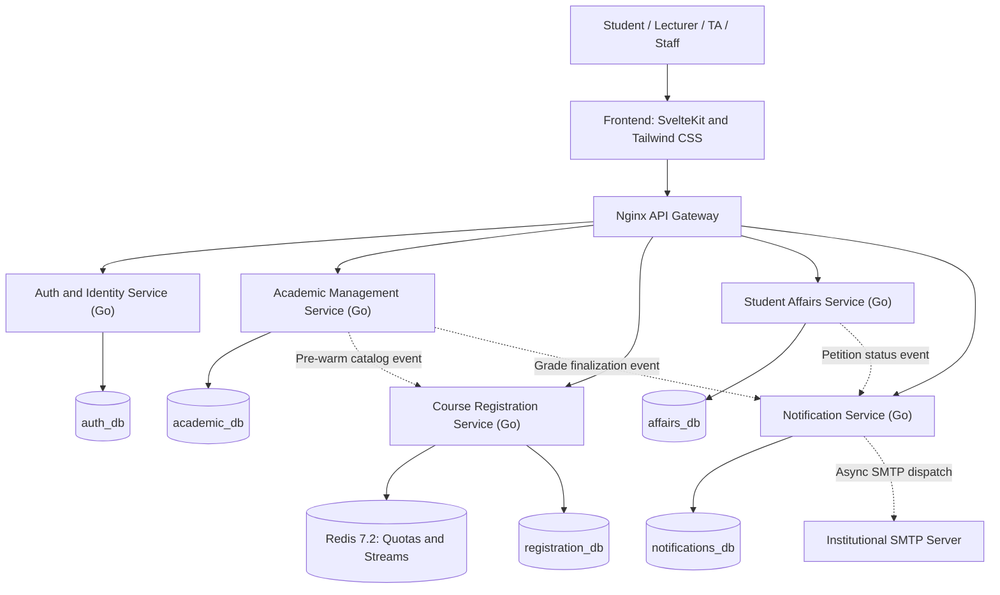
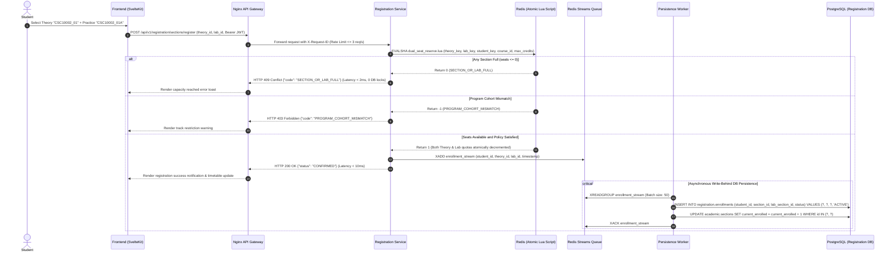
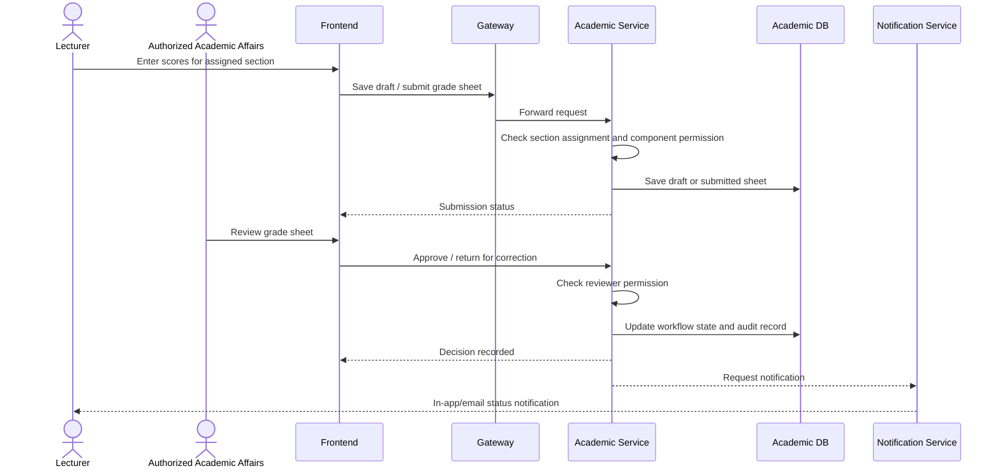
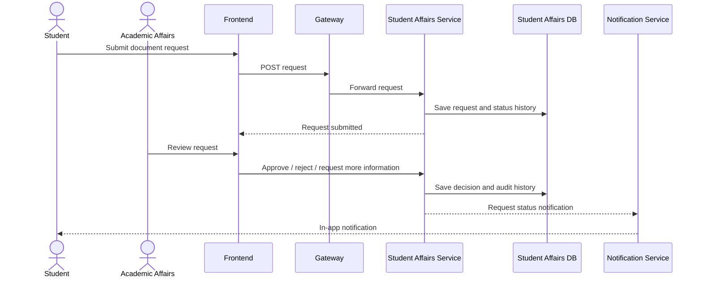

# Portal67 — Solution Architecture & Functional Specification

> **Project:** Portal67 — Unified Academic & Administrative Web Portal  
> **Course:** Introduction to Software Engineering — HK1, 2026–2027  
> **Department:** Software Engineering Department, Faculty of Information Technology, HCMUS  
> **Team:** Team 02 — BDD  
> **System Architect:** Vũ Trần Minh Hiếu  
> **Document version:** 3.0  
> **Status:** Baseline for PA3 Phase Gate Submission & Solution Architecture  
> **Lead Architect / Author:** Vũ Trần Minh Hiếu (MSSV: 24127003)  
> **Scope:** Portal only. Moodle/LMS integration is explicitly out of scope for this project version.

---

## 0. Document purpose and conventions

This document defines the proposed functional scope, role model, business rules, domain model, service boundaries, API direction, and implementation roadmap for Portal67. It is intended to be the working baseline for requirements analysis, UI wireframes, PA3 system design, API contracts, database design, test planning, and implementation.

The design is intentionally pragmatic. It includes microservices to meet the project's learning objectives, but avoids introducing Kubernetes, a service mesh, Kafka, or other operational infrastructure that is not necessary for a semester project.

### Requirement priority

| Priority | Meaning |
|---|---|
| **Must** | Required for the core demonstration and coherent academic workflows |
| **Should** | Valuable, but may be delivered after the core workflow |
| **Could** | Optional enhancement if time permits |
| **Out of scope** | Explicitly excluded from the current project version |

### Important assumptions

1. Portal67 is a **course project prototype**, not an official replacement for HCMUS production systems.
2. The Portal is the source of truth for the academic records that this prototype manages, especially official grades within the prototype.
3. Moodle is not integrated in this version. Course learning materials can be represented by an optional external link, but Portal67 will not provision Moodle users, enrol students, or synchronize Moodle grades.
4. Exact university policies can vary by faculty, cohort, academic year, and training program. Configurable rules are preferred over hard-coded assumptions.
5. The current feature set is a proposed design, not a claim that every listed workflow is currently handled in exactly this way by HCMUS.
6. Financial transactions, certificates, health-related records, and official academic records are simulated or use sample data for the course project unless a real authorized integration is explicitly approved.

---

# 1. System overview

## 1.1. Problem statement

Students and lecturers need a unified place to view academic information and complete common academic workflows. Information can otherwise be distributed across separate portals, spreadsheets, forms, and announcements. During course-registration periods, users also need a clear way to compare class sections and construct a suitable timetable.

Portal67 aims to provide a role-aware web portal for:

- Student academic overview and self-service.
- Course and section discovery, registration, and timetable planning.
- Official grade viewing and lecturer grade entry.
- Exam schedules and examination-related requests.
- Student affairs forms and request tracking.
- Tuition overview and selected administrative workflows.
- Lecturer teaching schedules, assigned classes, grade entry, and class communication.
- Administrative management of academic data, approvals, and reports.

## 1.2. Design goals

1. **One coherent portal:** users should not need to navigate unrelated pages for common academic tasks.
2. **Role-aware access:** a user sees and changes only information they are authorized to access.
3. **Clear separation of duties:** lecturers enter grades; authorized academic-affairs staff review, approve, and finalize them.
4. **Student-controlled schedule planning:** the planner helps students compare possible schedules; a timetable conflict is shown as information rather than automatically blocking a selection.
5. **Configurable academic structures:** academic program, cohort, specialization, and course-component differences must not be hard-coded to one fixed label.
6. **Auditable workflows:** sensitive actions such as grade changes, document approval, and role assignment leave an audit trail.
7. **Pragmatic microservices:** service boundaries should demonstrate independent responsibilities without creating excessive deployment and debugging overhead.
8. **Demo-friendly:** seed data and a controlled demo-login flow support course evaluation without weakening the normal authentication design.

## 1.3. Non-goals

The following are not required in the current project baseline:

- Moodle integration, LMS synchronization, or Moodle grade import.
- A complete student information system for every HCMUS faculty.
- Full accounting, payment settlement, or banking integration.
- A native iOS/Android application.
- Production-scale infrastructure such as Kubernetes, service mesh, or multi-region deployment.
- Automated academic decisions based on AI.
- Automatic blocking of course registration because of timetable overlaps.
- Automatic prerequisite enforcement unless the team later receives a confirmed policy requirement.
- A full library management system connected to the university library's live catalog.

---

# 2. HCMUS context and academic-program modeling

## 2.1. Program categories & Multi-Track Academic Separation

HCMUS and the Faculty of Information Technology (FIT) operate under two primary academic tracks with fundamentally distinct operational, administrative, and curriculum schedules:

1. **Chương trình Chuẩn (Đại trà - Standard Track):**
   - **Term Structure:** 2 official semesters per academic year (HK1: Sep–Jan, HK2: Feb–Jun), plus an optional summer semester.
   - **Administrative Unit:** Managed by **Phòng Đào tạo (PĐT)** and Department Academic Affairs officers.
   - **Campus & Seating:** Instruction primarily occurs at **Cơ sở 2 (Linh Trung, TP. Thủ Đức)** during lower-division years; class capacities range from 80 to 150 students.
   - **Financial Mechanism:** Regulated state tuition calculated per credit based on subsidized public rates.

2. **Chương trình Đề án (Project-Based Track - CLC / Tiên tiến APCS / Việt - Pháp):**
   - **Term Structure:** **3 official trimesters per academic year** (HK1: Sep–Dec, HK2: Jan–Apr, **HK3: May–Aug**). HK3 is an integral, mandatory term in the curriculum roadmap rather than an optional summer session.
   - **Administrative Unit:** Managed independently by the **Văn phòng các Chương trình Đào tạo theo Đề án (VP Đề án - CTĐA / OEP)** located within FIT (`ctda.hcmus.edu.vn`).
   - **Campus & Seating:** Instruction takes place centrally at **Cơ sở 1 (227 Nguyễn Văn Cừ, Quận 5)** with air-conditioned classrooms, dedicated computer labs, smaller class sizes (35–50 students), and allocated Teaching Assistants (TAs).
   - **Financial Mechanism:** Financially autonomous tuition model approved under university scheme rates.

### BCNF-Normalized Data Model for Programs and Semesters

To prevent data anomalies and preserve **Boyce-Codd Normal Form (BCNF)** across varying track calendars:

1. **`academic.programs` Entity:**
   - `id UUID PRIMARY KEY DEFAULT gen_random_uuid()`
   - `program_code VARCHAR(20) UNIQUE NOT NULL` (e.g. `'CNTT_CHUAN'`, `'KHMT_APCS'`, `'CNTT_CLC'`, `'CNTT_VP'`)
   - `program_name VARCHAR(100) NOT NULL`
   - `program_type VARCHAR(20) NOT NULL CHECK (program_type IN ('STANDARD', 'PROJECT_BASED'))`
   - `total_semesters_per_year SMALLINT NOT NULL CHECK (total_semesters_per_year IN (2, 3))`
   - `managing_unit VARCHAR(50) NOT NULL CHECK (managing_unit IN ('PHONG_DAO_TAO', 'VP_DE_AN'))`

2. **`academic.semesters` Entity:**
   - `id UUID PRIMARY KEY DEFAULT gen_random_uuid()`
   - `academic_year VARCHAR(10) NOT NULL` (e.g. `'2026-2027'`)
   - `term_number SMALLINT NOT NULL CHECK (term_number BETWEEN 1 AND 3)`
   - `program_type VARCHAR(20) NOT NULL CHECK (program_type IN ('STANDARD', 'PROJECT_BASED'))`
   - `start_date DATE NOT NULL`
   - `end_date DATE NOT NULL CHECK (end_date > start_date)`
   - `status VARCHAR(15) NOT NULL CHECK (status IN ('UPCOMING', 'ACTIVE', 'COMPLETED'))`
   - *Constraint:* `UNIQUE (academic_year, term_number, program_type)` prevents duplicate term configurations.

3. **`academic.students` Entity:**
   - Holds only `program_id UUID NOT NULL REFERENCES academic.programs(id)`.
   - *Proof of BCNF Compliance:* Bypasses transitive dependencies ($mssv \rightarrow program\_id \rightarrow program\_type$). In `students`, candidate keys are $id$ and $mssv$; in `programs`, candidate keys are $id$ and $program\_code$. Every determinant is a superkey, completely eliminating update anomalies when modifying program characteristics.

## 2.2. Faculty and administrative structure

The application should represent the organizational structure at a level useful for the project:

- University
- Faculty/department
- Academic program
- Cohort or intake year
- Administrative class (if needed)
- Course and course offering
- Lecturer and lecturer assignment

For the project demo, one faculty can be seeded with several program categories. The data model should nevertheless avoid assumptions that all faculties use identical workflows.

## 2.3. Specialization and seminar registration

The system should support a workflow for students who need to select a specialization around the end of the second academic year, as described in the project requirements.

It should also support **special-topic/seminar registration** as a configurable academic activity. These are not necessarily the same as ordinary course registration:

- **Specialization registration:** student submits a preference or ranked choices during an official registration window; authorized staff review and publish the result.
- **Seminar registration:** student selects an available seminar/class/session, subject to the configured capacity and registration window.

The exact timing, selection criteria, ranking, quota, and approval procedure must be configurable because they may vary by program or cohort. Do not hard-code “end of year 2” as an unconditional rule in the database; represent the registration window and eligible cohort as configuration.

---

# 3. User identity, roles, and permissions

## 3.1. Identity model: email is not the only identifier

The proposed account identity is based on a verified email address, while the person record uses an institution-specific identifier:

- **Student:** student ID / MSSV.
- **Lecturer or staff member:** staff ID / mã số cán bộ, where available.
- **Login/contact:** verified email address.
- **Internal identifier:** immutable UUID or equivalent primary key.

Do not use the person's full name as a unique identifier. Names are not guaranteed to be unique and can change. Email addresses may also change, so the internal user ID must remain stable.

A suggested separation is:

- `users`: authentication identity and account status.
- `student_profiles`: MSSV and student-specific attributes.
- `staff_profiles`: staff code and staff-specific attributes.
- `user_roles`: role assignments and scope.

Email should be unique within the identity system. MSSV and staff code should be unique within their respective identifier namespaces. The project can use seeded email addresses and demo accounts rather than attempting real institutional account provisioning.

## 3.2. Three primary account groups, with additional scoped roles

The top-level product experience can remain simple:

1. **Student**
2. **Lecturer**
3. **Admin / Academic Affairs**

However, “lecturer” should not imply unrestricted authority. A lecturer may also serve as an academic advisor, head of a department, or an authorized academic-affairs officer. These are additional assignments or permissions, not reasons to create separate accounts.

### Recommended role/permission model

Use **RBAC with scope constraints**:

- **RBAC:** determines which actions a user may perform.
- **Scope:** determines which students, classes, courses, departments, or requests the user may access.
- **Assignment:** records why a user has that scope, such as being assigned to teach a section or advise a cohort.

Examples:

- A lecturer can enter Mathematics scores only for sections they teach and only for authorized grade components.
- A lecturer teaching Mathematics cannot modify Literature scores unless explicitly assigned the corresponding permission and scope.
- An academic advisor can view the academic progress of assigned advisees but cannot automatically edit their grades.
- A head of department can approve certain requests only if the relevant permission has been granted.
- Academic-affairs staff can manage broad academic data according to their assigned duties.
- A system administrator manages technical configuration and accounts but does not automatically receive permission to alter official grades.

## 3.3. Role catalogue

| Role / assignment | Typical scope | Key permissions |
|---|---|---|
| `STUDENT` | Own account and records | View own profile, grades, timetable, tuition overview; register courses; submit requests |
| `LECTURER` | Assigned teaching sections | View assigned class rosters, teaching schedule, enter authorized grades, send class announcements |
| `ACADEMIC_ADVISOR` | Assigned advisees | View assigned students' academic progress; provide advising notes if included |
| `DEPARTMENT_HEAD` | Assigned department | Review/approve explicitly delegated workflows and view department-level reports |
| `ACADEMIC_AFFAIRS` | Assigned faculty/program or broader authorized scope | Manage academic data, review and finalize grades, process academic requests, publish official information |
| `SYSTEM_ADMIN` | Technical system scope | Manage accounts, roles, service configuration, operational logs; no implicit right to alter grades |
| `AUDITOR` (optional) | Read-only audit scope | Review audit records and selected reports without changing business data |

The user interface can present three primary dashboards while the authorization layer supports additional role assignments. A person may hold several assignments at once. If the user switches between work contexts, the UI should make the active context visible.

## 3.4. High-level permission matrix

Legend: **Own** = own records; **Assigned** = explicitly assigned scope; **Manage** = create/update within authorized scope; **Approve** = approve only if assigned; **—** = no default permission.

| Function | Student | Lecturer | Advisor | Academic Affairs | Dept. Head | System Admin |
|---|---|---|---|---|---|---|
| View own profile | Own | Own | Own | Own | Own | Own |
| Edit protected academic fields | — | — | — | Manage | — | — |
| View student profile | Own | Assigned | Assigned advisees | Manage | Department scope | Only as operationally necessary |
| Course catalogue | View | View | View | Manage | View/approve if assigned | — |
| Create course offerings/sections | — | — | — | Manage | Approve if assigned | — |
| Course registration | Own | View assigned roster | View advisees | Manage exceptions | Approve exceptions if assigned | — |
| View timetable | Own | Assigned | Assigned advisees | Manage/publish | Department scope | — |
| Enter grades | — | Assigned sections/components | — | Only if explicitly delegated | Only if explicitly delegated | — |
| Review/finalize grades | — | Submit/view status | — | Approve/finalize if authorized | Approve if delegated | — |
| Change finalized grade | Request only | Submit change request | — | Process under policy | Approve if delegated | — |
| Exam schedule | Own | Assigned | Assigned advisees | Manage/publish | Department scope | — |
| Student document requests | Own | View/act only if assigned | View if relevant | Process/approve | Approve if delegated | — |
| Tuition overview | Own | — | — | Manage within finance scope | Reports if authorized | — |
| Publish announcements | — | Assigned classes | Assigned advisees if allowed | Manage official notices | Department scope | — |
| Account/role management | — | — | — | Limited operational access if delegated | — | Manage |
| Audit logs | — | — | — | Limited business audit scope | If authorized | Operational access |

This matrix is a starting point. The backend must enforce permissions; hiding a button in the frontend is not an authorization control.

---

# 4. Student Portal — functional specification

## 4.1. Student dashboard

**Priority: Must**

The dashboard should answer: “What do I need to know or do today?”

### Main sections

1. **Student summary**
   - Full name and MSSV.
   - Faculty, major, academic program, cohort/intake year, and current study year.
   - Current academic status.
   - Current cumulative GPA/CPA, where available.
   - Credits completed and credits required by the configured curriculum.
   - Latest training-point (ĐRL) result, where available.
   - Academic advisor and contact channel.

2. **Today's schedule**
   - Classes ordered by start time.
   - Course code/name, lecture or practice type, section code, time, room, and lecturer.
   - Link to the full timetable.
   - Clear empty state when there are no classes today.

3. **Pending tasks and requests**
   - Document requests awaiting review.
   - Grade-appeal status.
   - Exam postponement/retake requests.
   - Tuition extension request.
   - Certificate verification status.
   - Other active student-affairs tickets.

4. **Announcements**
   - University-wide notices.
   - Faculty/program notices relevant to the student.
   - Registration deadlines, exam updates, grade publication, and tuition deadlines.
   - Read/unread state and publication date.

5. **GPA trend**
   - Semester GPA chart.
   - Cumulative GPA/CPA trend.
   - Explicitly distinguish official values from any forecast or simulation.

6. **Quick actions**
   - Register courses.
   - View timetable.
   - View grades.
   - Submit a certificate/document request.
   - View tuition.
   - View exam schedule.

### Business rules

- The dashboard only aggregates data the logged-in student is authorized to view.
- Missing or not-yet-published values should be displayed as “Chưa có dữ liệu” rather than interpreted as zero.
- Forecast GPA must be labeled as an estimate, not an official academic result.
- Only currently relevant announcements should dominate the dashboard; expired announcements remain accessible in the announcement archive if required.

## 4.2. Student profile

**Priority: Must**

### Sections

- **Identity:** full name, MSSV, profile photo (optional), date of birth if required, and institutional email.
- **Academic:** faculty, major, academic program, cohort, administrative class, current study status, academic advisor.
- **Contact:** phone number, current address, permanent address, emergency contact if required.
- **Family:** selected guardian/contact information if the project requires it.
- **Health and insurance:** only the minimum fields necessary for a clearly defined use case, such as health-insurance status/expiry. Avoid collecting detailed medical history in the prototype.
- **Achievements and certificates:** approved achievements, language certificates, and other recognized credentials.
- **Student card:** optional visual representation for UI polish. A rendered card is not proof of identity and must not be treated as a replacement for an official physical/digital student card.

### Edit policy

Students may edit only explicitly permitted contact fields. MSSV, official name, program, cohort, academic status, grades, and other protected fields must be changed by authorized staff through controlled workflows.

Health, family, and insurance data are sensitive. They should be omitted from the MVP unless a concrete requirement exists. If retained for demonstration, use fictional seed data and restrict access by scope.

## 4.3. Timetable

**Priority: Must**

The timetable should support both a list and a weekly calendar.

### Filters

- Academic year.
- Semester.
- Course/subject.
- Section type: lecture (LT), practice/lab (TH), seminar, or other configured type.
- Optional view: registered sections only or a personal planning draft.

### Views

1. **Registered-course list**
   - Course code and name.
   - Credits.
   - Selected lecture section.
   - Selected practice/lab section, if applicable.
   - Lecturer, room, and schedule.
   - Registration status.

2. **Weekly calendar**
   - Monday–Sunday columns.
   - Time slots based on the university timetable data.
   - Visually distinguish lecture, practice/lab, exams, and personal planning items.
   - Show room, time, course code, and section.
   - Allow navigation between weeks or the selected semester.

3. **Conflict indicators**
   - Display overlapping events with a visible warning.
   - Explain which events overlap.
   - Do not automatically remove or reject a student’s selection merely because a conflict exists.

### Business rules

- The official timetable is derived from the registered section records and published schedule data.
- The planner may show a draft timetable before registration is committed.
- A conflict warning is advisory under this project’s current policy.
- Course registration must not create duplicate registrations for the same student and same section.
- A student can have a lecture section and a practice section for one course where the course structure supports both.

## 4.4. Course registration and schedule optimization

**Priority: Must**

The registration experience combines course discovery, section selection, schedule planning, and high-concurrency seat reservation executed via the dedicated **Course Registration Service** (`registration-service`).

### A. Browse Courses & Smart Cohort Partitioning

Courses and sections are pre-warmed in Redis partitions (`catalog:{term}:STANDARD` vs. `catalog:{term}:PROJECT_BASED`) and filtered by:

- **Program Track Alignment:**
  - **Standard Track Students:** Interface defaults to active Standard terms (HK1 or HK2) and displays only classes with `target_program_type = 'STANDARD'`. Project-Based classes are hidden by default; in general exploration mode, they render disabled with a warning badge: *"Chỉ dành cho SV Đề án — VP Đề án quản lý"*.
  - **Project-Based Students:** Interface displays 3 official term selectors: **HK1, HK2, and HK3 (Summer Trimester)**. Defaults to Project-Based classes with an optional tab: *"Đăng ký học chéo (Cross-Registration)"* showing Standard sections flagged with `is_cross_enrollment_allowed = TRUE`.
- Course code / name / department.
- Modality: Theory (`THEORY`) vs. Practice (`PRACTICE`).
- Campus location (CS1 Nguyễn Văn Cừ vs. CS2 Linh Trung) mapped from physical classrooms (`academic.classrooms`).
- Real-time seating capacity meter (Green $< 80\%$, Amber $80\% - 99\%$, Red $100\%$).

### B. Course and Section Hierarchy (Theory-Practice Pairing)

To match actual university course structures under strict BCNF normalization:

- **Course:** Defines the subject in the catalog (e.g., `CSC10002` - Data Structures, 4 credits). Contains the boolean flag `has_lab`:
  - `has_lab = FALSE`: Pure theoretical subject (e.g., Calculus, Philosophy). Only opens `THEORY` sections (`parent_section_id = NULL`).
  - `has_lab = TRUE`: Integrated course (e.g., Data Structures, Computer Networks). Opens 1 `THEORY` section (lecture hall, 120 seats) and multiple child `PRACTICE` sections (computer labs, 35–40 seats each).
- **Section Modality:** Strictly partitioned into `THEORY` and `PRACTICE`:
  - `THEORY`: Primary lecture offering (`parent_section_id = NULL`).
  - `PRACTICE`: Sub-group lab session (`parent_section_id NOT NULL`, referencing parent Theory section).
- **Physical Classroom Decoupling:** Classrooms are isolated into `academic.classrooms` with building, campus, capacity, and room type, linked via `academic.section_schedules.classroom_id`.
- **Multi-Faculty Assignment:** Teaching duties are decoupled into `academic.section_lecturers` ($N:M$) supporting co-lecturers and lab TAs.
- **Registration Record:** A confirmed enrollment in `registration.enrollments` records both `section_id` (Theory) and `lab_section_id` (Practice lab), ensuring unified gradebook and billing evaluation.

### C. Student-Controlled Selection Policy & High-Concurrency Engine

For this version:

- **Flash-Crowd Concurrency Protection:** Registrations are handled by `registration-service` via Redis atomic Lua scripts (`dual_seat_reserve.lua`). When enrolling in a course with lab, the script atomically decrements seat quotas for both the Theory section and the selected child Practice section in sub-2ms, preventing race conditions without database locks.
- **Asynchronous Write-Behind Queue:** Confirmed reservations are enqueued to Redis Streams and committed in batch transactions to PostgreSQL by background persistence workers.
- **Advisory Overlap Warnings:** Schedule conflicts are rendered with an amber warning tooltip (*"Lịch học trùng với học phần [Mã lớp] — Quy chế nhà trường khuyến nghị không trùng giờ nhưng không chặn đăng ký"*), allowing student self-determination under academic advisor guidance.
- **Program Boundary Enforcement:** The API rejects mismatched registrations (`HTTP 403 Forbidden: PROGRAM_COHORT_MISMATCH`) if a Standard student attempts to enroll in a Project-Based section.
- **Accordion UI Experience:** Selecting a Theory section dynamically expands an interactive Accordion displaying available child Practice lab groups with individual meeting times and computer lab locations.

### D. Schedule planner based on the supplied repository

Reference: [zeeptobean/schedule_planner](https://github.com/zeeptobean/schedule_planner).

The repository README describes a Python/Flask planner that parses course/section data, distinguishes lecture and practice sections, searches for non-overlapping timetable combinations, supports user-selected sections, and ranks candidate schedules by preferences such as days off and number of days on campus. It also describes credit/course-count warnings and exporting schedules.

For Portal67, reuse the **product idea and algorithmic approach**, not necessarily the entire application or its scraping workflow. The repository currently describes extracting HTML from an existing portal; Portal67 should instead provide its own structured course/section data through an API.

#### Recommended user flow

1. Student selects the academic term.
2. Portal displays the available courses and sections.
3. Student marks courses they want to consider.
4. Student can pin a specific section or leave the section choice to the planner.
5. Student sets preferences:
   - maximize full days off;
   - minimize the number of days on campus;
   - cluster classes into fewer days;
   - avoid selected days if possible;
   - optionally prefer morning/afternoon slots.
6. Planner generates multiple candidate timetables.
7. Student compares candidates and selects one.
8. Student reviews warnings and submits the actual registrations.
9. Portal displays the confirmed registrations and weekly timetable.

#### Suggested optimization strategy

This is a combinatorial search problem when the student selects multiple courses and each course has multiple sections. A simple backtracking/constraint-search algorithm is suitable for the course project.

- **Hard constraints:** avoid choosing the exact same section twice; obey the actual registration window; respect section capacity at commit time if capacity is enabled.
- **Soft preferences:** no timetable overlap, more days off, fewer campus days, preferred time of day.
- **Policy exception:** timetable overlap is a warning, not a submission blocker in this project's current requirements.

Because overlap is advisory, the planner may rank conflict-free options above conflicting ones without deleting conflicting options from the result set. If a student explicitly pins overlapping sections, preserve the choice and label the conflict.

The planner must not claim that the generated schedule is officially registered until the registration API confirms the selections. Schedule generation and registration submission are separate operations.

#### Suggested API boundaries

- `GET /api/v1/academic/terms/{termId}/offerings`
- `GET /api/v1/academic/offerings/{offeringId}/sections`
- `POST /api/v1/academic/schedule-plans`
- `POST /api/v1/academic/schedule-plans/{planId}/generate`
- `GET /api/v1/academic/schedule-plans/{planId}/candidates`
- `POST /api/v1/academic/registrations`
- `DELETE /api/v1/academic/registrations/{registrationId}`

The planner can initially be implemented as a module inside the Academic Service. If the team wants to demonstrate a separate optimization service later, extract it only after the API contract and input/output data structures are stable.

## 4.5. Grades and academic progress

**Priority: Must**

### Views

- Semester summary.
- Course-level details.
- Official cumulative GPA/CPA.
- Credit totals: registered, completed, and remaining against the configured curriculum.
- Grade scale used by the applicable program.
- Grade publication status.
- Curriculum progress view showing completed/incomplete course groups, where curriculum data is available.

### GPA forecast

A “what-if” calculator can let a student enter hypothetical future grades and see an estimated GPA change. It must be visually and technically separated from official grades.

### Business rules

- Official grade records are maintained by Portal67.
- Only authorized lecturers can enter scores for assigned sections and permitted components.
- Academic-affairs staff or another explicitly authorized approver reviews and finalizes grade sheets.
- A finalized grade cannot be silently overwritten.
- Grade changes after finalization require a request, reason, authorization, and audit trail.
- The calculation formula, rounding rule, and grading scale must be configurable rather than assumed to be universal.

## 4.6. Training points (Điểm rèn luyện / ĐRL)

**Priority: Should**

Features:

- View current and historical semester results.
- View the applicable evaluation criteria.
- Submit self-assessment if included in the selected workflow.
- Attach evidence where required.
- Track submission, review, and finalization statuses.
- Display the official result only after it is approved/published.

The criteria and weighting should be versioned by semester if the rules change. Do not assume that every semester uses the same scoring form.

## 4.7. Exam schedule

**Priority: Must**

Provide both a list view and a calendar/timetable view.

Fields:

- Course and section.
- Exam date and time.
- Exam duration.
- Room/location.
- Candidate number (SBD), when applicable.
- Exam format.
- Notes and required materials.
- Status: scheduled, changed, cancelled, or completed.

Rules:

- Show conflicts clearly, but do not silently modify exam assignments.
- Changes to published exams must preserve change history and trigger notifications.
- The official exam schedule is maintained by authorized academic-affairs staff.

## 4.8. Exam postponement and retake requests

**Priority: Should**

Students select the relevant course/exam and submit one of the request types:

- **Exam postponement:** request to be absent from or defer an exam under the applicable policy.
- **Retake registration:** request to participate in an available retake/resit examination, if offered by the faculty/policy.

Suggested workflow:

`DRAFT → SUBMITTED → UNDER_REVIEW → APPROVED / REJECTED → COMPLETED`

Features:

- Select an eligible exam/course.
- Enter a reason.
- Upload supporting evidence if required.
- View submission timestamp and status.
- Read reviewer comments.
- Receive a notification when the request changes state.

The project should not automatically approve a request based only on the uploaded file. Approval remains a human decision under the configured workflow.

## 4.9. Grade appeal (Phúc khảo)

**Priority: Must**

Features:

- Select a published grade/course component eligible for appeal.
- Display the appeal window and deadline.
- Enter the reason and submit supporting information if required.
- Track status and decision.
- Display the final result after authorized review.

Rules:

- A student can only appeal their own eligible grade.
- The system must enforce the configured submission window.
- A grade appeal is a request to review, not an automatic grade update.
- The reviewer must be authorized and should not silently overwrite the original record.
- The audit trail must record the request, decision, old score, new score if changed, reviewer, timestamp, and reason.

## 4.10. Certificates and administrative documents

**Priority: Must for a basic document-request workflow; individual document types may be staged**

The document center should be template-driven. Instead of creating a separate hard-coded page for every certificate, define document types and their required fields.

Potential document types:

- Student-status verification.
- Military-service deferment/confirmation (NVQS), if applicable.
- Bank-loan confirmation.
- Visa/foreign-study support confirmation.
- Achievement confirmation.
- Training-point confirmation.
- Introduction letter.
- Transcript issuance.
- Other faculty/university-specific forms.

Each document type can define:

- Required fields.
- Required attachments.
- Processing unit/role.
- Approval workflow.
- Output template.
- Fee, if applicable.
- Availability window and expected processing time.
- Whether the result is downloadable or requires physical collection.

### Request lifecycle

`DRAFT → SUBMITTED → UNDER_REVIEW → (NEED_MORE_INFO) → APPROVED / REJECTED → ISSUED / COMPLETED`

Students must be able to see the status, submission date, comments, and resulting document where applicable.

A generated PDF is a project artifact, not an officially valid university certificate unless it is actually issued through an authorized official process.

## 4.11. Certificate submission and verification

**Priority: Should**

Students can submit language or other certificates, such as IELTS or VSTEP, for review.

Fields:

- Certificate type.
- Issuing organization.
- Certificate number (if applicable).
- Issue date and expiry date (if applicable).
- Score/result.
- Attachment.
- Submission status.
- Reviewer decision and notes.

Workflow:

`SUBMITTED → UNDER_REVIEW → VERIFIED / REJECTED → RECORDED`

The application must distinguish between a student-submitted certificate and a verified certificate. A submitted attachment is not considered verified until an authorized reviewer completes the process.

## 4.12. Transcript issuance

**Priority: Should**

Features:

- Select transcript type (unofficial view, certified paper copy, or demo PDF).
- Select language/format if supported.
- Submit a request and track status.
- Display fees or collection instructions only if configured.
- Generate a demo PDF from official Portal records for the prototype.

Do not claim that a generated PDF has cryptographic or legal validity unless signature verification and issuance authority are actually implemented.

## 4.13. Tuition overview and tuition-extension requests

**Priority: Must for overview; Should for extension request/payment simulation**

Tuition dashboard:

- Academic term.
- Itemized amount due.
- Credits or billing items included.
- Amount paid (seed/simulated data).
- Outstanding balance.
- Due date.
- Payment status.
- Applicable program/tuition category, where configured.

The prototype can simulate payment status. It must not collect real bank credentials or imply that a real payment has been settled.

Tuition-extension workflow:

`DRAFT → SUBMITTED → UNDER_REVIEW → APPROVED / REJECTED → COMPLETED`

The request includes a reason, requested extension date, supporting evidence if needed, reviewer, and decision.

## 4.14. Scholarships

**Priority: Could**

- List available scholarships.
- Show eligibility information and deadlines.
- Submit an application and attachments.
- Track review status.
- Show outcome and reviewer comments.

Eligibility rules should be data-driven where possible. The prototype must not imply an official award until an authorized reviewer records the result.

## 4.15. Leave of absence, suspension, and withdrawal

**Priority: Could / Should depending on project scope**

Provide an information page and request workflow for:
- Temporary study suspension / bảo lưu.
- Withdrawal / thôi học.
- Other academic-status requests if required.

These are high-impact academic actions. The Portal should collect a request and route it for review, not change a student's official status immediately after a button click.

## 4.16. Surveys

**Priority: Could**

- List surveys available to the student.
- Show opening and closing dates.
- Save a draft if needed.
- Submit a response and show completion status.
- Prevent duplicate submissions when the survey policy requires one response per student.

For the project, use sample survey data. Survey answers should not be exposed to lecturers or other students unless the survey policy explicitly permits it.

## 4.17. Library services

**Priority: Out of scope for MVP; Could for a demo**

Potential future features:

- Search a sample library catalog.
- View book availability.
- Reserve a study room.
- Request/record a book loan.
- View due dates and reservation status.

Without an authorized library-system integration, these are simulated workflows only. The initial project should prioritize academic and student-affairs features over building a second library-management system.

---

# 5. Lecturer Portal — functional specification

## 5.1. Lecturer dashboard

**Priority: Must**

The dashboard should show:

- Today's teaching schedule.
- Upcoming classes, rooms, and section types.
- Assigned course sections.
- Grade-entry deadlines and pending grade sheets.
- Upcoming exams or invigilation duties, if assigned.
- Announcements from the university/faculty.
- Requests awaiting lecturer action, if any.
- Quick links to class rosters, grade entry, timetable, and announcements.

### Student leave requests

A lecturer may be able to view student absence/leave requests related to their assigned class, but this must not imply a universal approval authority.

Recommended behavior:

- Students submit a request through the student portal.
- The request is routed according to its type and configured workflow.
- A lecturer may mark attendance-related acknowledgement or add a comment if assigned.
- Academic-affairs staff or another designated role makes the official decision where required.
- The lecturer only sees requests relevant to their assigned classes and the minimum necessary details.

For the MVP, a lightweight “class absence notice” can be implemented, but it should be clearly distinguished from official exam postponement or study suspension requests.

## 5.2. Teaching timetable

**Priority: Must**

- Weekly and list views.
- Academic-term filter.
- Course/section code and name.
- Lecture/practice/lab type.
- Room and time.
- Assigned teaching role.
- Exam/invigilation schedule, if assigned.
- Historical changes to published schedules.
- Optional request for a room change or make-up class.

A lecturer can submit a change request but should not directly overwrite the official timetable unless explicitly authorized.

## 5.3. Assigned class management & Co-Teaching Support

**Priority: Must**

For each assigned section:

- **Multi-Faculty Co-Teaching & TA Assignment:** A section can have $\ge 1$ assigned faculty via `academic.section_lecturers` ($N:M$):
  - `PRIMARY`: Lead Professor responsible for curriculum and official gradebook submission.
  - `CO_LECTURER`: Co-instructor sharing theory lecture sessions.
  - `TA`: Teaching Assistant guiding practical computer laboratory sections.
- View student roster filtered by Theory class vs. child Practice lab groups.
- Search/filter students.
- View limited student information necessary for teaching.
- Export a roster/attendance sheet.
- View section capacity and real-time registered count.
- View schedule, physical classroom location (`academic.classrooms`), and course information.
- Send announcements to that section.

Lecturers should not be able to browse every student record in the university by default.

## 5.4. Grade entry and grade-sheet workflow

**Priority: Must**

### Grade entry

- Select an assigned section (Theory or Practice).
- Select an authorized grade component populated dynamically from `academic.grade_components`.
- Enter or import scores from a validated template.
- Validate score ranges (0.0 to `max_score`) and required fields.
- Preview calculated totals (calculated dynamically to satisfy BCNF without storing redundant summary columns).
- Save a draft.
- Submit the grade sheet for review.
- View reviewer feedback and current status.

### Grade workflow

`DRAFT → SUBMITTED → UNDER_REVIEW → APPROVED → FINALIZED / PUBLISHED`

Alternative transitions may include `RETURNED_FOR_CORRECTION` and `REJECTED`, depending on the configured workflow.

### Separation of duties

- **Role-Based Submission Control:** While Co-lecturers and TAs can input and save continuous component scores (e.g. Lab reports), only the **Primary Lecturer** (`is_primary = TRUE`) has authority to lock and submit the grade sheet to Academic Affairs.
- Authorized academic-affairs staff review, approve, and finalize official grade sheets (`Submitted` $\rightarrow$ `Finalized`).
- A lecturer cannot modify another lecturer's class grades without explicit assignment in `section_lecturers`.
- A lecturer cannot edit student identity, program, tuition, or other unrelated records through grade-entry permission.
- A finalized grade change requires a separate correction request and audit trail (`Grade_Correction_Log`).

The system must enforce these restrictions in the backend, not only in the UI.

## 5.5. Learning-material links

**Priority: Could**

Moodle integration is out of scope. A course/section may optionally store an external learning-material URL for demonstration, but Portal67 will not:

- create or manage Moodle accounts;
- synchronize enrolments;
- upload course files to Moodle;
- read or write Moodle grades;
- maintain a Moodle service token.

## 5.6. Class announcements

**Priority: Must**

Lecturers can create announcements for:
- a section they teach;
- a group explicitly assigned to them;
- a class activity under their responsibility.

An announcement includes title, body, audience, publication time, expiry time (optional), and author. Sending to all students or all faculties requires a separate permission.

## 5.7. Teaching reports and analytics

**Priority: Should**

- View grade-entry completion.
- View score distribution for assigned sections.
- Export class roster and authorized grade sheet.
- Identify missing grades.
- Compare component-level distributions.
- View the status of submitted grade sheets.

Analytics should be descriptive. The system should not automatically label a student as failing or academically at risk without a defined, approved rule.

---

# 6. Academic Affairs / Admin Portal

Academic-affairs staff handle a substantial amount of the school's operational work. The system should therefore provide a functional work queue and bulk-management tools rather than treating the role as a simple “view all data” administrator.

## 6.1. Academic data management

**Priority: Must**

- Manage student and staff records within the assigned scope.
- Manage faculties/departments and academic programs.
- Manage courses and course offerings.
- Manage lecture/practice/lab sections.
- Assign lecturers to sections.
- Maintain academic terms and registration windows.
- Maintain course/program curriculum data.
- Import/export approved data templates.
- Publish official timetables and announcements.

## 6.2. Course and timetable operations

**Priority: Must**

- Create and update course offerings.
- Configure section type, capacity, lecturer, room, and schedule.
- View registration counts.
- Detect room and lecturer schedule conflicts.
- Publish and revise schedules.
- Track changes to published schedules.

For students, a schedule overlap is advisory under the current project policy. For administrative timetable construction, room and lecturer conflicts should still be highlighted because they represent operational inconsistencies.

## 6.3. Grade supervision and finalization

**Priority: Must**

- Configure grade-entry windows.
- Monitor submission status by course/section.
- Review submitted grade sheets.
- Return a sheet for correction with comments.
- Approve/finalize grades when authorized.
- Publish grades.
- Process grade correction requests.
- Export official grade sheets within the assigned scope.
- Review grade-change audit records.

The role is not simply “admin can edit every grade.” Grade changes must follow an explicit workflow with separation of duties.

## 6.4. Student-affairs request queue

**Priority: Must for one generic workflow; document types can be staged**

Provide a queue with:

- Request type.
- Student and program.
- Submission date.
- Deadline/SLA (if configured).
- Current status.
- Assigned reviewer.
- Required attachments.
- Missing information.
- Review decision and comments.
- Final output or completion note.

Authorized staff can filter, assign, request additional information, approve/reject, and close requests. The application should preserve a history of every state transition.

## 6.5. Tuition and scholarship administration

**Priority: Should / simulated for the course project**

- Manage tuition items and due dates.
- Import or seed payment status.
- Review tuition-extension requests.
- Manage scholarship announcements and applications.
- Export summary reports.

No real payment gateway is required for the MVP. Use an explicit `SIMULATED` payment state if a payment screen is included.

## 6.6. Reports

**Priority: Should**

- Student counts by program, cohort, and status.
- Course/section registration counts.
- Section capacity and demand.
- Grade-entry and publication progress.
- Grade distributions.
- Student-affairs request queue and processing status.
- Tuition overview from seeded data.
- Specialization/seminar registration outcomes.

Reports must respect the viewer's data scope. Exporting a report is a sensitive operation and should be audited where it includes personal or academic data.

## 6.7. System administration

**Priority: Must for basic operation**

- Manage user accounts and status.
- Assign roles and scopes.
- Configure application settings.
- View operational logs and failed background tasks.
- Seed demo accounts/data.
- Inspect health status of services.

Technical administrators should not receive implicit authority to approve student requests or modify official grades. Business permissions should be granted explicitly.

---

# 7. Business rules

The following are proposed rules for the project baseline. Any rule based on an unconfirmed HCMUS policy must remain configurable.

## 7.1. Identity and access

| ID | Rule |
|---|---|
| BR-ID-01 | Every account has an immutable internal identifier. |
| BR-ID-02 | Verified email is unique in the identity system; names are not unique identifiers. |
| BR-ID-03 | MSSV uniquely identifies a student within the student identifier namespace. |
| BR-ID-04 | Staff code uniquely identifies a staff member within the staff identifier namespace when such codes are available. |
| BR-ID-05 | A person can have multiple roles/assignments, but each permission is scoped. |
| BR-ID-06 | Every protected API checks authorization on the backend. |
| BR-ID-07 | Protected academic fields cannot be edited by students. |
| BR-ID-08 | Role changes and privileged actions are recorded in audit logs. |

## 7.2. Course registration

| ID | Rule |
|---|---|
| BR-REG-01 | Registration is available only during the configured registration window, unless an authorized exception is processed. |
| BR-REG-02 | A student cannot register the exact same section twice. |
| BR-REG-03 | A student may choose sections with overlapping timetable slots under the current project policy; the UI must warn but not block. |
| BR-REG-04 | Prerequisite enforcement is not enabled by default in this version. |
| BR-REG-05 | If section capacity is enabled, concurrent requests must not exceed it. |
| BR-REG-06 | A course can have lecture, practice/lab, seminar, or other section types; not every course must have every type. |
| BR-REG-07 | Registration of a section and schedule-planner selection are separate states; a generated plan is not a confirmed registration. |
| BR-REG-08 | Duplicate submissions should be handled safely and must not create duplicate registrations. |
| BR-REG-09 | Course/section changes after the registration window require the configured exception workflow. |
| BR-REG-10 | Maximum credits/course count must not be enforced unless the project team configures and documents that policy. |
| BR-REG-11 | **Program Track Cohort Isolation:** Standard track students (`STANDARD`) cannot register Project-Based sections (`PROJECT_BASED`). Project-Based students may only enroll in Standard sections if `is_cross_enrollment_allowed = TRUE` under formal academic petition. |
| BR-REG-12 | **Theory-Practice Pairing:** For courses where `has_lab = TRUE`, students must select exactly one Theory section (`THEORY`) and one child Practice lab group (`PRACTICE`) belonging to that Theory parent. |
| BR-REG-13 | **In-Memory Atomic Reservation:** Peak concurrent enrollment requests execute via Redis Lua scripts (`dual_seat_reserve.lua`), ensuring sub-2ms dual-seat deduction and zero over-subscription without database lock contention. |

The capacity rule is retained because a section may have a finite number of seats. If the prototype intentionally ignores capacity, document that as a demo simplification instead of implementing a misleading “remaining seats” value.

## 7.3. Grade management

| ID | Rule |
|---|---|
| BR-GRD-01 | Grade entry is scoped to the lecturer's assigned section and permitted grade components. |
| BR-GRD-02 | Score values and grading scales are validated against configuration. |
| BR-GRD-03 | Grade weights must be valid before a grade sheet can be finalized. |
| BR-GRD-04 | Lecturers submit grades; authorized academic-affairs staff review and finalize them. |
| BR-GRD-05 | Finalized grades cannot be silently overwritten. |
| BR-GRD-06 | A correction request records the old value, proposed value, reason, requester, reviewer, and timestamps. |
| BR-GRD-07 | Students can view only their own official grade records. |
| BR-GRD-08 | GPA calculations use a documented formula and rounding policy. |
| BR-GRD-09 | Forecast grades are separated from official grade records. |
| BR-GRD-10 | **Multi-Lecturer Assignment Permissions:** In co-taught sections (`academic.section_lecturers`), only the Primary Lecturer (`is_primary = TRUE`) can submit the complete grade sheet; co-lecturers and TAs have permissions to enter continuous component scores. |

## 7.4. Request workflows

| ID | Rule |
|---|---|
| BR-REQ-01 | A request has a defined type, owner, status, timestamps, and processing history. |
| BR-REQ-02 | Only authorized roles can approve/reject a request. |
| BR-REQ-03 | Requests can be returned for more information without losing the original submission history. |
| BR-REQ-04 | High-impact requests such as withdrawal or study suspension do not change official academic status immediately upon submission. |
| BR-REQ-05 | Generated documents are marked as draft/demo unless issued through an authorized official process. |
| BR-REQ-06 | Sensitive attachments are visible only to users assigned to process the request. |

## 7.5. Timetable

| ID | Rule |
|---|---|
| BR-TT-01 | Each scheduled session has a valid start/end time and associated course section. |
| BR-TT-02 | Administrative timetable management highlights room and lecturer conflicts. |
| BR-TT-03 | Student schedule overlaps are warnings, not automatic registration blockers. |
| BR-TT-04 | Published timetable changes retain a history and can trigger notifications. |
| BR-TT-05 | The planner displays the same structured section data that the registration API uses. |

## 7.6. Privacy and audit

| ID | Rule |
|---|---|
| BR-SEC-01 | Collect only personal data necessary for a defined feature. |
| BR-SEC-02 | Health, family, and insurance data are excluded from the MVP unless explicitly required. |
| BR-SEC-03 | Demo environments use fictional seed data for sensitive fields. |
| BR-SEC-04 | Passwords, tokens, and secrets are never written to application logs. |
| BR-SEC-05 | Grade changes, role changes, approval decisions, and sensitive exports are auditable. |
| BR-SEC-06 | Audit logs are protected from unauthorized alteration. |

---

# 8. Domain model and data ownership

## 8.1. Core entities (BCNF-Compliant Baseline)

| Entity | Purpose |
|---|---|
| `users` | Login identity, verified email, password hash, account status |
| `roles` / `permissions` | RBAC role definitions and granular authorizations |
| `user_roles` | Scoped user-to-role mappings |
| `students` | Student profile and MSSV, linked to `academic_programs` via `program_id FK` (BCNF compliant) |
| `staff_profiles` | Staff identity, staff code, and assigned faculty/office |
| `faculties` / `departments` | Organizational academic units |
| `academic_programs` | Degree tracks: Standard (`STANDARD`) vs. Project-Based (`PROJECT_BASED`), 2 vs. 3 terms/year, and managing unit (`PHONG_DAO_TAO` vs. `VP_DE_AN`) |
| `academic_semesters` | Academic school year, term number (1, 2, or 3 for summer trimester), program track, and dates |
| `classrooms` | Physical facility inventory: room code, building, campus (`CS1_NV_CU` vs. `CS2_LINH_TRUNG`), capacity, and room type |
| `courses` | Catalog subject record with `has_lab (BOOLEAN)` indicator |
| `course_sections` | Selectable class offering strictly typed into `THEORY` (lecture) or `PRACTICE` (lab), with `parent_section_id` hierarchy |
| `section_lecturers` | N:M co-teaching and TA faculty assignments with `PRIMARY`, `CO_LECTURER`, and `TA` roles |
| `section_schedules` | Scheduled meeting periods linked directly to `classroom_id` (preventing room double-booking) |
| `enrollments` | High-throughput confirmed registrations recording paired `section_id` (Theory) and `lab_section_id` (Practice) |
| `curricula` / `curriculum_courses` | Program curriculum roadmap and prerequisites |
| `grade_sheets` | Section evaluation rubric container and Four-Eyes review state |
| `grade_components` | Dynamic evaluation rubric items, weights (summing to 100%), and descriptions |
| `student_grades` | Component evaluation scores per student enrollment |
| `grade_correction_logs` | Immutable audit trail for approved post-finalization grade rectifications |
| `exams` / `exam_requests` | Formal examination timetables and postponement petitions |
| `grade_appeals` | Statutory 7-day student grade review petitions (`Phúc khảo`) |
| `student_affairs_requests` | Administrative document petitions and military deferments |
| `tuition_invoices` / `tuition_items` | Track-specific tuition billing statements and VietQR payment reconciliation |
| `notifications` | Asynchronous persistent in-app notifications and email dispatch logs |
| `audit_logs` | Tamper-resistant immutable system access and mutation logs |

## 8.2. Course hierarchy & Theory-Practice Pairing

```text
AcademicProgram (STANDARD: 2 terms/yr | PROJECT_BASED: 3 trimesters/yr)
  └── Semester (Term 1, 2, or 3)
        └── Course (has_lab: Boolean)
              └── Section: THEORY (parent_section_id = NULL, Lecture Hall at CS1/CS2)
                    ├── SectionSchedule -> Classroom (Hall / Theory Room)
                    ├── SectionLecturers (N:M) -> Primary Lecturer / Co-Lecturers
                    ├── GradeSheet -> GradeComponents -> StudentGrades
                    └── Child Section: PRACTICE (parent_section_id = Theory.id, Computer Lab at CS1)
                          ├── SectionSchedule -> Classroom (Computer Lab)
                          └── SectionLecturers (N:M) -> Lab TAs

Student (program_id FK -> AcademicProgram)
  └── Enrollment (section_id [THEORY], lab_section_id [PRACTICE])
```

This normalized hierarchy accommodates pure theory courses, integrated theory-plus-lab courses, and multi-lecturer co-teaching while preventing timetable collisions and room double-booking under strict BCNF.

## 8.3. Data ownership by microservice

Each microservice exercises authoritative ownership over its bounded domain data. Cross-service database mutations are strictly prohibited.

| Data Domain | Microservice Owner | Storage Technology & Schemas |
|---|---|---|
| Credentials, accounts, roles, persona switcher | **Auth & Identity Service** (Port 8081) | PostgreSQL (`auth` schema) |
| Programs, semesters, courses, sections, classrooms, schedules, section lecturers, grade sheets, components, student grades | **Academic Management Service** (Port 8082) | PostgreSQL (`academic` schema) |
| High-throughput enrollments, in-memory seat quotas, pre-warmed catalog partitions, schedule planner drafts | **Course Registration Service** (Port 8085) | Redis 7.2 (Lua counters & Streams) + PostgreSQL (`registration` schema) |
| Student petitions, certificates, tuition billing reconciliation, scholarship applications | **Student Affairs Service** (Port 8083) | PostgreSQL (`affairs` schema) |
| Persistent in-app notifications, delivery logs, SMTP transactional emails | **Notification Service** (Port 8084) | PostgreSQL (`affairs.notifications` / Redis Goroutine Queue) |

The implementation may run one PostgreSQL server/container for local development, but should use separate logical databases or clearly separated schemas and credentials per service. Avoid a single shared set of tables that all services can freely mutate.

Cross-service references should use stable IDs. When a service needs data from another service, use an API call, a locally stored read model, or a small domain event—not direct cross-service SQL updates.

---

# 9. Proposed microservices architecture

## 9.1. Architecture decision

Use **pragmatic modular microservices orchestrated with Docker Compose**. To balance high operational velocity during semester development with strict fault isolation during peak course-registration flash crowds, the platform is decomposed into **5 autonomous microservices**:

1. **Frontend:** Single-page application built on SvelteKit, TypeScript, and Tailwind CSS.
2. **API Gateway / Reverse Proxy:** Nginx edge proxy enforcing TLS termination, per-student rate limiting (3 req/s), and path routing.
3. **Auth & Identity Service (Port 8081):** User credentials, PBKDF2/Argon2id hashing, Demo Persona Switcher, and scoped JWT issuance.
4. **Academic Management Service (Port 8082):** Master curricula, multi-track academic programs (Standard vs. Project-Based), terms (2 terms vs. 3 trimesters), course offerings, Theory/Practice section hierarchies, physical classrooms (`academic.classrooms`), co-teaching faculty assignments (`academic.section_lecturers`), and Four-Eyes gradebook workflows.
5. **Course Registration Service (Port 8085):** **Dedicated high-concurrency enrollment engine.** Decoupled from `academic-service` to isolate flash crowds at 8:00 AM. Employs in-memory Redis atomic Lua scripts (`dual_seat_reserve.lua`) for sub-2ms seat quota reservations and asynchronous message queue persistence (Redis Streams) to eliminate database connection pool starvation.
6. **Student Affairs Service (Port 8083):** Administrative student petitions, certificate generation, military deferments, grade appeals, and tuition billing tracking.
7. **Notification Service (Port 8084):** Asynchronous I/O-bound alert processing (in-app notifications and transactional SMTP emails).
8. **In-Memory Cache & Message Buffer:** Redis 7.2 hosting atomic seat counters, student eligibility sets, pre-warmed catalog caches, and the write-behind stream buffer.
9. **Persistent Relational Datastore:** PostgreSQL 16 utilizing strict schema-level bounded context isolation (`auth`, `academic`, `registration`, `affairs`).

## 9.2. C4-style container view



## 9.3. Service responsibilities

### Service 1 — Auth & Identity Service (Port 8081)

**Owns:** user identity, verified email, account state, role assignments, permission definitions, authentication sessions/tokens, and evaluation Demo Persona Switcher accounts.

Responsibilities:
- Login and logout.
- Scoped JWT issuance with role claims (`Student`, `Lecturer`, `Staff`, `Admin`).
- Demo Persona Switcher allowing instant persona impersonation for evaluation with zero external dependencies.
- Immutable audit log tracking for credential mutations and security events.

### Service 2 — Academic Management Service (Port 8082)

**Owns:** academic tracks (`academic.programs`), academic terms (`academic.semesters`), courses (`academic.courses`), course offerings and Theory/Practice hierarchies (`academic.sections`), physical classrooms (`academic.classrooms`), multi-lecturer assignments (`academic.section_lecturers`), weekly session schedules (`academic.section_schedules`), dynamic rubrics (`academic.grade_components`), official grade sheets (`academic.grade_sheets`), and student grades (`academic.student_grades`).

Responsibilities:
- Master curriculum catalog management.
- Semester lifecycle management (2 standard terms for Phòng Đào tạo vs. 3 trimesters for VP Đề án - CTĐA).
- Classroom facility inventory management across campus locations (CS1 Nguyễn Văn Cừ vs. CS2 Linh Trung).
- Dynamic assessment rubric configuration and score validations.
- Four-Eyes gradebook approval workflow (`Draft` $\rightarrow$ `Submitted` by Primary Lecturer $\rightarrow$ `Finalized` by Academic Staff).
- Calculation of GPA/CPA and publication to official transcripts.

### Service 3 — Course Registration Service (Port 8085)

**Owns:** high-throughput confirmed enrollments (`registration.enrollments`), student schedule planner drafts (`registration.planner_drafts`), and in-memory seat quotas.

Responsibilities:
- Smart program-cohort catalog partitioning (`catalog:{term}:STANDARD` vs. `catalog:{term}:PROJECT_BASED`).
- Cohort boundary enforcement (blocking Standard students from enrolling in Project-Based sections).
- Sub-2ms atomic seat reservation via Redis Lua scripts (`dual_seat_reserve.lua`), simultaneously deducting Theory and child Practice lab quotas.
- Write-behind queue buffering via Redis Streams (`XADD enrollment_stream`).
- Background consumer worker processing batch ACID inserts into `registration.enrollments` in PostgreSQL (`XREADGROUP` + `XACK`).
- Conflict detection advisory warnings and personal schedule draft generation.

### Service 4 — Student Affairs Service (Port 8083)

**Owns:** administrative student petitions (`affairs.student_requests`), certificate requests, military deferments, training point appeals, cross-enrollment petition queue, and simulated tuition billing reconciliation.

Responsibilities:
- Student petition intake, document attachment uploads, and workflow state resolution.
- Adjudication of Cross-Registration petitions from Project-Based students.
- Dynamic VietQR payment code generation and simulated billing reconciliation.

### Service 5 — Notification Service (Port 8084)

**Owns:** persistent in-app notifications, delivery logs, user notification preferences, and asynchronous email dispatch workers.

Responsibilities:
- Asynchronous consumption of domain events (enrollment receipts, grade publication alerts, petition status updates).
- Background worker email relay via SMTP with exponential backoff and failed event logging.
- WebSocket / polling feed for real-time dashboard notifications.

## 9.4. API gateway routing

Suggested routing:

| Public route | Upstream service | Purpose |
|---|---|---|
| `/api/v1/auth/**` | Auth & Identity (Port 8081) | Authentication, JWT, Demo persona switcher |
| `/api/v1/academic/**` | Academic Management (Port 8082) | Catalog, classrooms, schedules, gradebook |
| `/api/v1/registration/**`| Course Registration (Port 8085) | High-concurrency enrollment, planner |
| `/api/v1/affairs/**` | Student Affairs (Port 8083) | Petitions, certificates, tuition billing |
| `/api/v1/notifications/**`| Notification (Port 8084) | In-app alerts and delivery preferences |

## 9.5. Database strategy

Recommended project baseline:

- One PostgreSQL container orchestrated via Docker Compose.
- Strict schema-level bounded context isolation (`auth`, `academic`, `registration`, `affairs`).
- Redis 7.2 container for atomic seat quotas, streams, and pre-warmed catalogs.
- Dedicated database users/credentials per microservice where practical.
- Zero cross-service SQL joins or direct cross-schema mutations.
- Asynchronous write-behind worker pattern decoupling high-throughput enrollment commands from relational disk I/O.

This gives the team practical experience with data ownership and distributed service boundaries without requiring separate database servers.

## 9.6. Cross-service consistency

Microservices do not share one ACID transaction across all services. For the project, prefer simple, explicit workflows:

- Save the business transaction in its owning service.
- Record a durable notification/job request.
- Process the notification asynchronously.
- Retry transient failures.
- Make retries safe and observable.

For example, after a student-affairs request is approved, the Student Affairs Service commits the decision and records an event/outbox entry. The Notification Service then creates an in-app notification and optionally sends email. An email failure must not undo the approved request.

## 9.7. Authentication and authorization

### Normal authentication

The proposed normal path is institutional Google OAuth, provided the team can configure an authorized OAuth client and define the accepted email domain(s). The Auth Service verifies the OAuth response and maps the verified identity to a Portal67 account.

Do not assume that possession of an email address alone proves the user's role. Roles and scopes must come from Portal67's account/assignment records.

### Demo authentication

A one-click demo-login toolbar can help course evaluators test the system. It should:

- Be enabled only in the demo/development environment.
- Use preconfigured seed accounts and limited sample data.
- Never be enabled in a production deployment.
- Clearly label demo sessions.
- Avoid allowing the user to submit arbitrary role names or generate unrestricted admin tokens.

### JWT considerations

JWT claims can contain a stable user ID and limited identity metadata. Roles/scopes can be included for convenience, but the system must account for revocation and changes to permissions. Do not place sensitive personal data in the token. Each service validates the token and enforces the relevant permission and resource scope.

## 9.8. Technology baseline

| Layer | Proposed technology | Notes |
|---|---|---|
| Frontend | SvelteKit + TypeScript + Tailwind CSS | Responsive, accessible SPA (WCAG 2.1 AA compliant) |
| Gateway | Nginx | Path-based routing, TLS termination, and rate limiting (3 req/s) |
| Backend services | Go (Gin / Chi / Fiber) | Lightweight, idiomatic microservices with strict schema boundaries |
| In-Memory Engine | Redis 7.2 | Atomic Lua seat counters, student eligibility sets, pre-warmed catalogs, and stream queuing |
| Database | PostgreSQL 16 | Relational academic transactions with isolated schemas (`auth`, `academic`, `registration`, `affairs`) |
| API style | REST + JSON | Scoped Bearer JWT authorization and OpenAPI specs |
| Local orchestration | Docker Compose | Repeatable local/demo environment across 3 isolated bridge networks |
| CI | GitHub Actions | Formatting, linting, tests, image builds |
| Email | SMTP Relay | Transactional alerts processed asynchronously by background Goroutines |
| Scheduling algorithm | Go module initially; Python service only if justified | Combinatorial search engine generating conflict-free candidate timetables |

Technology is a proposed baseline, not a reason to rewrite existing working code. If the team has already committed to another stack, preserve the service boundaries and business rules while adapting the implementation.

---

# 10. Key sequence diagrams

## 10.1. Course registration and high-concurrency seat reservation



Timetable overlap is reported as an advisory warning tooltip, not a hard blocking rule.

## 10.2. Grade submission and finalization



The notification is asynchronous and does not determine whether the grade decision was committed.

## 10.3. Student document request



---

# 11. API design principles and example endpoints

These are illustrative Portal67 API endpoints, not existing HCMUS APIs.

## 11.1. API conventions

- Prefix APIs with `/api/v1`.
- Use consistent JSON request/response structures.
- Validate input on the server.
- Return appropriate HTTP status codes.
- Use pagination for list endpoints.
- Include request/correlation IDs in logs.
- Enforce authorization in the owning service.
- Keep OpenAPI definitions in each service.
- Do not expose database table structure as the public API contract.
- Use idempotency or duplicate protection for registration and request submission where appropriate.

## 11.2. Endpoint catalogue

| Service | Endpoint | Purpose |
|---|---|---|
| Auth | `POST /api/v1/auth/google` | Exchange/verify OAuth result and establish Portal session |
| Auth | `POST /api/v1/auth/demo-login` | Development/demo login only |
| Auth | `GET /api/v1/auth/me` | Return current identity and permitted roles |
| Academic | `GET /api/v1/academic/programs` | List degree tracks (Standard vs. Project-Based) |
| Academic | `GET /api/v1/academic/terms` | List academic terms (2 terms for Standard, 3 trimesters for Đề án) |
| Academic | `GET /api/v1/academic/classrooms` | List physical classroom inventory across CS1/CS2 |
| Academic | `GET /api/v1/academic/courses` | Search course catalogue (with `has_lab` flag) |
| Academic | `GET /api/v1/academic/sections` | List Theory and child Practice sections |
| Academic | `POST /api/v1/academic/sections/{id}/lecturers` | Assign co-teaching faculties and lab TAs |
| Academic | `GET /api/v1/academic/timetable/me` | Current user's timetable with CS1/CS2 location badges |
| Academic | `GET /api/v1/academic/grades/me` | Current student's official grades |
| Academic | `POST /api/v1/academic/sections/{id}/grade-sheets` | Create/submit a grade sheet, with scope checks |
| Academic | `POST /api/v1/academic/grade-sheets/{id}/submit` | Primary Lecturer locks and submits sheet to Academic Affairs |
| Academic | `POST /api/v1/academic/grade-sheets/{id}/decision` | Approve and finalize sheet (Academic Staff only) |
| Academic | `POST /api/v1/academic/grade-change-requests` | Request correction of finalized grades (`Grade_Correction_Log`) |
| Academic | `GET /api/v1/academic/exams/me` | Student exam schedule |
| Registration | `GET /api/v1/registration/sections` | Browse pre-warmed Redis catalog with smart track filtering |
| Registration | `POST /api/v1/registration/sections/register` | Atomic dual-seat registration (Theory + Practice lab) via Redis Lua |
| Registration | `DELETE /api/v1/registration/sections/{id}` | Drop active enrollment and release Redis seat quotas |
| Registration | `POST /api/v1/registration/planner/save` | Persist personal timetable drafts |
| Registration | `POST /api/v1/registration/planner/generate` | Generate conflict-free candidate timetables |
| Student Affairs | `GET /api/v1/student-affairs/requests/me` | List own petitions |
| Student Affairs | `POST /api/v1/student-affairs/requests` | Submit a document petition or military deferment |
| Student Affairs | `POST /api/v1/student-affairs/cross-registration` | Submit cross-enrollment request for Project-Based students |
| Student Affairs | `POST /api/v1/student-affairs/certificates` | Submit certificate for verification |
| Student Affairs | `GET /api/v1/student-affairs/tuition/me` | View itemized tuition summary with dynamic VietQR code |
| Student Affairs | `POST /api/v1/student-affairs/tuition-extensions` | Submit tuition extension request |
| Notifications | `GET /api/v1/notifications/me` | List persistent in-app notifications |
| Notifications | `PATCH /api/v1/notifications/{id}/read` | Mark a notification as read |
| Admin | `POST /api/v1/admin/users` | Manage accounts, roles, and Persona Switcher credentials |

## 11.3. Error handling

Use consistent errors, for example:

```json
{
  "error": {
    "code": "SECTION_CAPACITY_REACHED",
    "message": "This section has no remaining capacity.",
    "requestId": "example-request-id"
  }
}
```

The error message should be useful without leaking private data. A failed registration should not reveal another student's identity or private registration details.

---

# 12. Non-functional requirements

| Category | Project-level requirement |
|---|---|
| Security | Backend authorization, least privilege, protected secrets, input validation |
| Privacy | Minimize sensitive fields; use fictional demo data |
| Data integrity | Transactions, unique constraints, foreign keys within service-owned databases |
| Auditability | Track grade changes, approvals, role changes, and sensitive exports |
| Performance | Paginate large lists; measure course-registration endpoints under a documented demo load |
| Availability | Expose health checks and structured logs |
| Recovery | Document database backup/restore for the local demo |
| Maintainability | Per-service modules, migrations, tests, OpenAPI docs |
| Interoperability | Stable REST/JSON contracts |
| Accessibility/usability | Responsive layout, keyboard-accessible forms, clear validation messages |
| Observability | Correlation/request IDs, service health, failed-job visibility |
| Deployment | Reproducible Docker Compose setup |

Do not promise a production SLA or a particular requests-per-second number without a defined load model and measurements. For the course project, define a reproducible test dataset and report the measured result.

---

# 13. Delivery roadmap and acceptance criteria

## 13.1. Recommended implementation order

### Phase 0 — Requirement baseline

- Confirm primary workflows.
- Confirm role/scope matrix.
- Confirm which features are in MVP.
- Agree on course/section model.
- Agree on grade workflow and request states.
- Create ERD and API contracts.

**Exit criteria:** the team agrees on entity names, ownership, permissions, and core acceptance tests.

### Phase 1 — Foundation and service skeletons

- Create repository structure and service skeletons.
- Configure Docker Compose, Nginx, and PostgreSQL.
- Create separate service databases/schemas and migrations.
- Implement health checks and request IDs.
- Implement identity and demo login.
- Seed students, lecturers, and academic-affairs accounts.

**Exit criteria:** the frontend reaches each service through the gateway; unauthorized requests are rejected.

### Phase 2 — Academic core

- Academic terms, programs, courses, offerings, and sections.
- Section types (lecture/practice/lab).
- Registration and drop.
- Timetable views.
- Basic schedule planner.
- Lecturer class roster.

**Exit criteria:** a student can browse sections, create a draft plan, register sections, and view the resulting timetable.

### Phase 3 — Grades

- Lecturer grade entry and import template.
- Grade sheet draft/submission.
- Academic-affairs review/finalization.
- Student grade view and GPA summary.
- Grade correction request and audit trail.

**Exit criteria:** a lecturer cannot edit an unassigned section; finalized grades cannot be silently overwritten.

### Phase 4 — Student-affairs requests and notifications

- Generic request types and statuses.
- Document request submission/review.
- Certificate submission.
- Tuition overview/extension simulation.
- In-app notifications.
- Optional email delivery.

**Exit criteria:** students can submit and track a request; authorized staff can process it; the state transition is recorded and the student is notified.

### Phase 5 — Secondary features and hardening

- Exam schedule and exam-related requests.
- Grade appeal.
- Training points.
- Specialization and seminar registration.
- Surveys, scholarships, or library mockup if time permits.
- Authorization tests, integration tests, backup/restore documentation.
- Final demo script.

**Exit criteria:** the main workflows pass the acceptance tests and the environment can be started from a clean checkout using the documented instructions.

## 13.2. MVP scope recommendation

For a semester project, implement a complete end-to-end slice rather than many incomplete pages.

**Recommended MVP:**
1. Authentication and demo roles.
2. Student dashboard/profile.
3. Course offerings and lecture/practice sections.
4. Schedule planner and registration.
5. Student timetable.
6. Lecturer class roster and grade entry.
7. Academic-affairs grade review/finalization.
8. Student grades/GPA view.
9. Generic student document request and review.
10. In-app notifications.
11. Audit logging for sensitive operations.
12. Docker Compose and a repeatable demo dataset.

**Second priority:** exam schedule, grade appeals, certificate verification, tuition overview/extension, specialization/seminar registration, and training points.

**Optional:** real email delivery, scholarships, surveys, and library simulation.

## 13.3. Acceptance test matrix

| ID | Scenario | Expected result |
|---|---|---|
| AC-01 | Student attempts to view another student's grades | Backend denies access |
| AC-02 | Lecturer enters a grade for an unassigned section | Backend denies the operation |
| AC-03 | Lecturer tries to edit student identity fields through grade APIs | Operation is denied |
| AC-04 | Lecturer submits a valid grade sheet for an assigned section | Sheet is saved and enters the review workflow |
| AC-05 | Academic-affairs reviewer approves a submitted sheet | Decision and audit record are persisted |
| AC-06 | User attempts to change a finalized grade directly | Rejected; correction workflow required |
| AC-07 | Student selects two overlapping sections | UI shows a warning; selection is not automatically blocked by overlap |
| AC-08 | Student submits the same section twice | Duplicate registration is prevented |
| AC-09 | Two students attempt to take the last seat concurrently when capacity is enabled | Capacity is not exceeded |
| AC-10 | Student generates a timetable candidate but does not submit registration | No official registration is created |
| AC-11 | Student submits a document request | Request is persisted and visible in the student's request history |
| AC-12 | Unauthorized lecturer attempts to approve a document request | Backend denies the operation |
| AC-13 | A request is returned for additional information | Status/history is preserved; student can respond |
| AC-14 | A notification email fails | Core business transaction remains committed; failure is observable/retryable |
| AC-15 | A system admin attempts to change an official grade without business permission | Operation is denied |
| AC-16 | User accesses health/family information outside their scope | Backend denies access |
| AC-17 | A student changes program category in the browser payload | Backend ignores/rejects unauthorized field changes |
| AC-18 | Specialization registration window is closed | Submission is rejected with a clear reason |
| AC-19 | Course has lecture sections but no practice sections | Registration and timetable UI remain valid |
| AC-20 | Timetable is changed after publication | Change history is preserved and relevant users are notified |

---

# 14. Risks, open decisions, and external references

## 14.1. Open decisions

The following should be resolved during requirements review:

1. Which student-program labels and cohort-specific rules should appear in the demo dataset?
2. Is course capacity enforced in the MVP, or only displayed as sample information?
3. Are lecture and practice sections registered independently, or should selected courses model a required pairing?
4. Which grade components and GPA/CPA calculation rules should the demo use?
5. Which student-affairs request types will be fully implemented versus represented by a generic request workflow?
6. Is Google OAuth available to the team, or should the demo rely on preconfigured accounts?
7. Should email delivery be implemented, or are in-app notifications sufficient?
8. Will the schedule planner be a module in the Academic Service or a separate service? Recommended initial choice: module in the Academic Service.
9. Which sensitive profile fields should be excluded entirely from the prototype?
10. Which role is authorized to approve each request type?

## 14.2. Risks and mitigations

| Risk | Mitigation |
|---|---|
| Scope grows too large | Freeze MVP; use a generic request workflow for multiple document types |
| Academic rules are assumed incorrectly | Make rules configurable and label unconfirmed policy as an assumption |
| Microservices create excessive complexity | Start with four services and one local PostgreSQL container with isolated databases |
| Shared database causes tight coupling | Enforce data ownership, separate migrations, and no cross-service writes |
| Schedule planner is mistaken for official registration | Separate plan generation from registration submission and confirmation |
| Grade permissions are too broad | Use scoped permissions and backend authorization tests |
| Demo login leaks privileged access | Enable only in development/demo and use seeded sample accounts |
| Sensitive personal data is exposed | Minimize data collection and use fictional data |
| Notification failure breaks a workflow | Commit the business transaction first and process notification asynchronously |
| Project tries to integrate systems it does not own | Keep Moodle and real payment integrations out of scope |

## 14.3. References

These public references informed the context and design. They do not replace official internal policies or the course's approved requirements.

1. **HCMUS Student Handbook — Faculty information and contacts**  
   https://stsv.hcmus.edu.vn/gioi-thieu-ve-khoa  
   The public page lists FIT program-related contacts including Standard/Talent, English-enhanced, APCS, and academic advising. Program labels should therefore be configurable rather than hard-coded as a universal taxonomy.

2. **FIT HCMUS — Advanced Program (APCS)**  
   https://www.ctda.hcmus.edu.vn/vi/educational-program/chuong-trinh-tien-tien/  
   Public information describes APCS and its English-medium teaching context. The exact program configuration used in Portal67 should be based on the selected cohort/faculty data.

3. **HCMUS — Training Office**  
   https://hcmus.edu.vn/phong-dao-tao/  
   The Training Office publishes academic-year timetable and regulation notices. Portal67 should model official academic data and policy as configurable records.

4. **FIT HCMUS — APCS program information**  
   https://www.fit.hcmus.edu.vn/dai-hoc/chuong-trinh-tien-tien  
   Additional program background and curriculum links.

5. **zeeptobean/schedule_planner — GitHub repository**  
   https://github.com/zeeptobean/schedule_planner  
   Reference for the student-facing schedule-planning concept, section selection, timetable candidate generation, preference-based ranking, and schedule export. Portal67 should use structured Portal APIs instead of relying on scraping an external production portal.

6. **OWASP Authorization Cheat Sheet**  
   https://cheatsheetseries.owasp.org/cheatsheets/Authorization_Cheat_Sheet.html  
   Supports least privilege, default-deny authorization, checking permissions on every request, and testing access-control behavior.

7. **NIST SP 800-53 Rev. 5 — Security and Privacy Controls**  
   https://csrc.nist.gov/pubs/sp/800/53/r5/upd1/final  
   A reference for access control, audit, and accountability concepts. The course project should apply an appropriate subset rather than attempting to implement the full control catalogue.

---

# Appendix A — Suggested repository structure

```text
portal67/
├── frontend/
│   ├── src/
│   └── Dockerfile
├── gateway/
│   └── nginx.conf
├── services/
│   ├── auth-service/
│   │   ├── cmd/
│   │   ├── internal/
│   │   ├── migrations/
│   │   ├── openapi/
│   │   └── Dockerfile
│   ├── academic-service/
│   │   ├── cmd/
│   │   ├── internal/
│   │   │   ├── courses/
│   │   │   ├── registration/
│   │   │   ├── schedule/
│   │   │   ├── grades/
│   │   │   ├── exams/
│   │   │   └── curriculum/
│   │   ├── migrations/
│   │   ├── openapi/
│   │   └── Dockerfile
│   ├── student-affairs-service/
│   │   ├── cmd/
│   │   ├── internal/
│   │   │   ├── requests/
│   │   │   ├── certificates/
│   │   │   ├── tuition/
│   │   │   └── scholarships/
│   │   ├── migrations/
│   │   ├── openapi/
│   │   └── Dockerfile
│   └── notification-service/
│       ├── cmd/
│       ├── internal/
│       ├── migrations/
│       ├── openapi/
│       └── Dockerfile
├── deploy/
│   └── docker-compose.yml
├── docs/
│   ├── design/
│   │   ├── system-architecture-spec.md
│   │   ├── c4-context.md
│   │   ├── erd.md
│   │   └── adr/
│   ├── api/
│   └── test/
├── scripts/
│   ├── seed/
│   └── dev/
└── README.md
```

This is a suggested structure. Avoid creating empty packages for every future feature before the core flow works.

# Appendix B — Proposed Architecture Decision Records (ADRs)

## ADR-001: Use pragmatic microservices with Docker Compose

**Status:** Accepted

**Context:** The project has a semester deadline but includes microservices and high-concurrency resilience as core architectural objectives.

**Decision:** Implement Auth & Identity, Academic Management, Course Registration, Student Affairs, and Notification as five autonomous microservices behind Nginx reverse proxy. Run them locally with Docker Compose.

**Consequences:**
- Demonstrates independent service ownership and REST APIs.
- Isolates peak registration spikes from core gradebook and student affairs operations.
- Adds operational complexity compared with a monolith, but remains reproducible via a single `docker compose up`.
- Avoids Kubernetes and a service mesh in the MVP.

## ADR-002: Academic Service owns official grades

**Status:** Accepted

**Context:** Lecturer grade entry and academic-affairs review/finalization must be separated.

**Decision:** The Academic Service owns official grade records and grade workflow state. Lecturers enter and submit scores for assigned sections. Authorized academic-affairs staff review and finalize.

**Consequences:**
- Clear ownership of grade calculations and audit records.
- Permission checks are centralized in the Academic Service.
- Grade correction is a workflow rather than an unrestricted update.

## ADR-003: Model course offerings and sections separately

**Status:** Accepted

**Context:** A course can have lecture and practice sections, and not every course has both.

**Decision:** Use `Course → CourseOffering → CourseSection`; each section has a configurable type.

**Consequences:**
- Supports multiple lecture/practice groups without duplicating the course catalogue.
- Enables timetable generation from a consistent structure.
- Leaves room for future section pairing rules without forcing them into the MVP.

## ADR-004: Timetable conflicts are advisory for student registration

**Status:** Accepted

**Context:** The current project requirement is to let students organize their own schedules and allow overlapping selections.

**Decision:** The planner ranks conflict-free schedules more favorably and displays warnings for overlaps, but registration is not blocked solely because of a timetable overlap.

**Consequences:**
- Preserves student choice.
- Requires the UI to make conflicts visible.
- Does not remove operational conflict detection for room/lecturer scheduling by academic-affairs staff.

## ADR-005: Keep Moodle integration out of scope

**Status:** Accepted

**Context:** This document specifies the Portal only.

**Decision:** No Moodle API client, account mapping, enrolment sync, or grade synchronization will be implemented in the current version.

**Consequences:**
- Reduces scope and dependency risk.
- Portal course/section data remains self-contained.
- Moodle integration can be considered in a future version through a separate adapter.

## ADR-006: Use email for contact/login mapping, not as the primary person key

**Status:** Accepted

**Context:** Students have MSSV; staff may have a staff code; names and emails can change.

**Decision:** Use an immutable internal user ID as the primary key, verified email as a login/contact identifier, MSSV for students, and staff code for staff.

**Consequences:**
- Avoids identity ambiguity.
- Supports email changes without rewriting academic records.
- Allows one person to have multiple scoped roles.

## ADR-007: Decouple Course Registration into Dedicated Microservice with In-Memory Redis Lua and Write-Behind Queue

**Status:** Accepted

**Context:** Peak enrollment opens at 8:00 AM, creating massive concurrent request spikes (flash crowds) that cause severe database lock contention and connection pool starvation if handled via monolithic relational transactions (`SELECT FOR UPDATE`).

**Decision:** Extract Course Registration into a standalone microservice (`registration-service`, Port 8085) with isolated database schemas (`registration`) and horizontal scalability. Seat quota deduction is executed in-memory via Redis atomic Lua scripts (`dual_seat_reserve.lua`) in $< 2\text{ms}$. Confirmed seat reservations are pushed to Redis Streams and committed in batch transactions to PostgreSQL by background persistence workers.

**Consequences:**
- Complete fault isolation: registration flash crowds cannot degrade core institutional operations (grading, transcript viewing, student affairs).
- Zero over-subscription guaranteed by single-threaded in-memory atomic Lua scripts.
- Eliminates relational database connection starvation during peak enrollment windows.

## ADR-008: Multi-Track Academic Model (HCMUS Standard vs. Project-Based) and Theory-Practice Section Hierarchy

**Status:** Accepted

**Context:** HCMUS operates distinct academic calendars and administrative offices for Standard (Đại trà - 2 semesters/yr, managed by Phòng Đào tạo) vs. Project-Based (Đề án / CLC / APCS / VP - 3 trimesters/yr including HK3, managed by VP Đề án - CTĐA). Furthermore, integrated courses require splitting large lecture cohorts into smaller computer lab groups with co-teaching faculties and physical classrooms.

**Decision:**
1. Model distinct degree tracks via `academic.programs` and `academic.semesters` with `program_type` segregation and term count (2 vs 3).
2. Decouple physical classrooms into `academic.classrooms` (`room_code`, `building`, `campus` CS1/CS2, `room_capacity`, `room_type`) referenced via `section_schedules.classroom_id`.
3. Model Theory-Practice section hierarchies via `academic.sections` with `section_type` (`THEORY` vs `PRACTICE`) and self-referencing `parent_section_id`.
4. Support co-teaching faculties and lab TAs via `academic.section_lecturers` ($N:M$).
5. Enforce smart cohort catalog partitioning in Redis (`catalog:{term}:STANDARD` vs `catalog:{term}:PROJECT_BASED`) and hard barrier cross-enrollment restrictions.

**Consequences:**
- Achieves 100% mathematical compliance with Boyce-Codd Normal Form (BCNF) across all relational schemas.
- Perfectly realizes real-world HCMUS academic operations, facilities, and faculty assignments.
- Prevents course over-subscription, timetable collisions, and room double-booking.

---

**End of document.**
