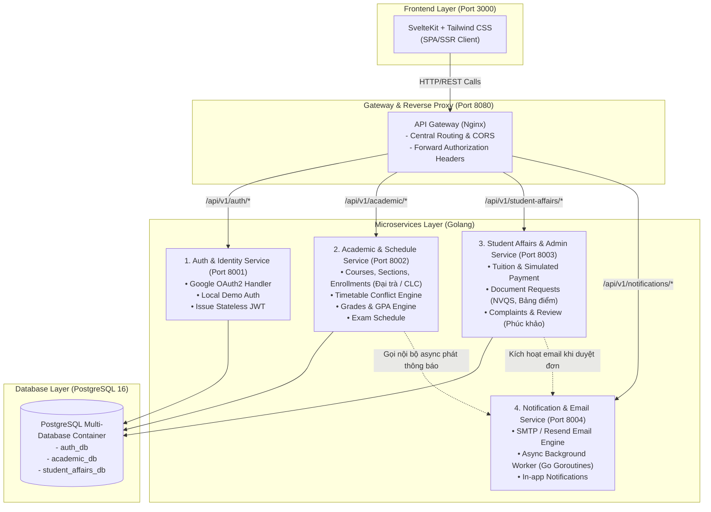
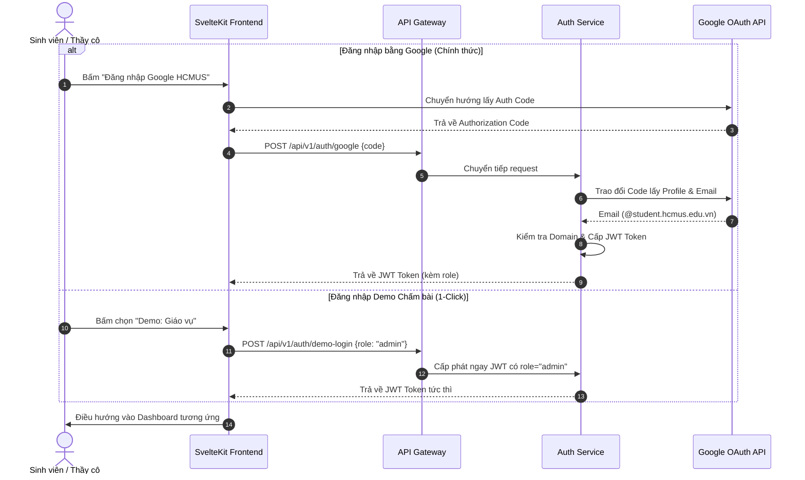

# TÀI LIỆU THIẾT KẾ KIẾN TRÚC & ĐẶC TẢ PHÂN HỆ HỆ THỐNG PORTAL67
**Dự án:** Portal67 - Cổng thông tin Học vụ & Hành chính Tích hợp HCMUS  
**Môn học:** Nhập môn Công nghệ Phần mềm (Intro to SE) - HK1, 2026–2027  
**Nhóm thực hiện:** Nhóm 02 (BDD)  
**Tác giả (System Architect):** Vũ Trần Minh Hiếu (24127003)  
**Ngày cập nhật:** 25/10/2026  
**Phiên bản:** 1.0 (Phục vụ PA2 - Requirements & PA3 - System Design)

---

## 1. TỔNG QUAN HỆ THỐNG (SYSTEM OVERVIEW)

### 1.1. Bối cảnh & Vấn đề giải quyết
Hiện nay tại Trường Đại học Khoa học Tự nhiên (HCMUS), sinh viên và giảng viên thường phải phân mảnh trải nghiệm trên nhiều hệ thống khác nhau:
- Phân cách giữa hệ thống dành cho hệ **Đại trà** và hệ **Chất lượng cao (CLC)**.
- Đăng ký học phần, tra cứu thời khóa biểu, nộp học phí, xin giấy xác nhận sinh viên và phúc khảo điểm phân tán trên nhiều website, biểu mẫu Google Form và công cụ không chính thức.

**Portal67** được xây dựng nhằm mục tiêu hợp nhất các dịch vụ học vụ, hành chính và thi cử trên một nền tảng web hiện đại, có phân quyền chặt chẽ, tối ưu hóa trải nghiệm người dùng và áp dụng kiến trúc **Microservices tinh gọn (Pragmatic Microservices)** vận hành cục bộ thông qua Docker Compose.

---

## 2. PHÂN HỆ NGƯỜI DÙNG & MA TRẬN CHỨC NĂNG (RBAC & FUNCTIONAL BREAKDOWN)

Hệ thống phục vụ 3 nhóm đối tượng chính với các chức năng chi tiết được phân rã như sau:

```
                            ┌──────────────────────────────────────┐
                            │               PORTAL67               │
                            └──────────────────┬───────────────────┘
               ┌───────────────────────────────┼───────────────────────────────┐
               ▼                               ▼                               ▼
    ┌─────────────────────┐         ┌─────────────────────┐         ┌─────────────────────┐
    │      SINH VIÊN      │         │      GIÁO VIÊN      │         │       GIÁO VỤ       │
    │  (Đại trà & CLC)    │         │     (Lecturer)      │         │   (Academic Staff)  │
    └─────────────────────┘         └─────────────────────┘         └─────────────────────┘
```

---

### 2.1. Phân hệ SINH VIÊN (Student Portal)
Áp dụng cho 2 đối tượng đào tạo:
* **Sinh viên Đại trà (Standard Program)**
* **Sinh viên Chất lượng cao (High Quality - CLC Program)**: Có quy chế đăng ký học phần riêng, mức tính học phí đặc thù và các lớp kỹ năng/tiếng Anh tăng cường.

| Nhóm chức năng | Tên tính năng chi tiết | Mô tả nghiệp vụ | Mức độ ưu tiên (MoSCoW) |
| :--- | :--- | :--- | :--- |
| **1. Tổng quan** | **Trang chủ (Dashboard)** | Xem thông báo quan trọng từ nhà trường/khoa, lịch học/lịch thi trong ngày, nhắc nhở hạn đóng học phí và các công việc cần làm (to-do list). | **Must-have** |
| | **Hồ sơ cá nhân (Profile)** | Xem/chỉnh sửa thông tin liên lạc cá nhân, thông tin lý lịch, cố vấn học tập, lớp sinh hoạt, niên khóa và chương trình đào tạo (Đại trà / CLC). | **Must-have** |
| **2. Học vụ** | **Đăng ký học phần (ĐKHP)** | Tìm kiếm, xem danh sách môn học & lớp học phần mở (phân theo Đại trà/CLC), kiểm tra sĩ số thời gian thực, kiểm tra trùng lịch tự động, gửi đăng ký / hủy môn. | **Must-have** |
| | **Thời khóa biểu (TKB)** | Hiển thị lịch học tuần/tháng dạng lưới trực quan, chi tiết phòng học, ca học, giảng viên phụ trách, hỗ trợ lọc theo học kỳ. | **Must-have** |
| | **Bảng điểm & Dự báo GPA** | Tra cứu điểm theo từng học kỳ (thang 10 & thang 4), tính GPA học kỳ và CPA tích lũy. Công cụ giả định điểm để dự báo GPA tốt nghiệp. | **Must-have** |
| | **Điểm rèn luyện (ĐRL)** | Xem lịch sử ĐRL các kỳ, bảng tự chấm điểm rèn luyện trực tuyến theo khung tiêu chí của trường và theo dõi trạng thái phê duyệt. | **Should-have** |
| | **Lịch thi** | Hiển thị danh sách ca thi, ngày thi, giờ thi, số báo danh, phòng thi và hình thức thi (tự luận, trắc nghiệm, vấn đáp). Cảnh báo trùng lịch thi. | **Must-have** |
| | **Phiếu khảo sát** | Làm khảo sát đánh giá môn học và giảng viên cuối mỗi học kỳ (điều kiện để mở khóa xem điểm sớm). | **Could-have** |
| **3. Thi cử** | **Đăng ký hoãn / thi lại** | Nộp đơn trực tuyến xin hoãn thi (đính kèm minh chứng bệnh/lý do chính đáng) hoặc đăng ký thi lại/cải thiện điểm. | **Should-have** |
| | **Phúc khảo điểm** | Nộp đơn yêu cầu chấm phúc khảo cho môn học cụ thể trong thời hạn quy định; theo dõi quy trình xử lý và cập nhật điểm sau phúc khảo. | **Must-have** |
| **4. Giấy tờ** | **Giấy xác nhận sinh viên** | Đăng ký cấp giấy xác nhận trực tuyến (tạm hoãn Nghĩa vụ quân sự - NVQS, vay vốn ngân hàng, xin việc làm, bảo hiểm y tế). | **Must-have** |
| | **Đăng ký cấp bảng điểm** | Yêu cầu in bảng điểm song ngữ, bảng điểm có mộc hoặc cấp file PDF có chữ ký số xác thực. | **Should-have** |
| | **Xác nhận chứng chỉ** | Nộp hồ sơ xét chuẩn đầu ra ngoại ngữ (IELTS, TOEIC...) và tin học (MOS); tra cứu kết quả thẩm định từ giáo vụ. | **Should-have** |
| **5. Tài chính** | **Tra cứu học phí** | Xem chi tiết học phí từng môn, tổng học phí học kỳ, hạn nộp, các khoản giảm trừ (miễn giảm diện chính sách). Phân biệt đơn giá tín chỉ Đại trà vs CLC. | **Must-have** |
| | **Gia hạn học phí** | Nộp đơn xin gia hạn thời hạn đóng học phí kèm lý do, theo dõi kết quả xét duyệt từ phòng công tác sinh viên. | **Should-have** |
| | **Học bổng** | Tra cứu danh sách học bổng khuyến khích học tập (KKHT) và học bổng doanh nghiệp; nộp hồ sơ đăng ký xét tuyển học bổng. | **Could-have** |
| **6. Thư viện** | **Tra cứu & Tài khoản Thư viện** | Tra cứu danh mục giáo trình, liên kết hệ thống thư viện trung tâm, theo dõi hạn trả sách đang mượn. | **Could-have** *(Deferred)* |

---

### 2.2. Phân hệ GIÁO VIÊN (Lecturer Portal)

| Chức năng | Mô tả nghiệp vụ | Mức độ ưu tiên |
| :--- | :--- | :--- |
| **1. Trang chủ** | Tổng hợp lịch giảng dạy trong ngày/tuần, các mốc thời gian quan trọng (hạn nộp bảng điểm, lịch thi), danh sách việc cần xử lý. | **Must-have** |
| **2. Quản lý lớp học & Học sinh** | Xem danh sách các lớp học phần được phân công; tra cứu danh sách sinh viên theo lớp, xuất danh sách điểm danh, gửi thông báo nhanh đến sinh viên trong lớp. | **Must-have** |
| **3. Thời khóa biểu giảng dạy** | Xem lịch dạy hàng tuần, thông tin phòng học, ca học; đăng ký yêu cầu dạy bù / đổi phòng học khi có sự cố. | **Must-have** |
| **4. Theo dõi kết quả học tập** | Nhập và chỉnh sửa điểm thành phần (chuyên cần, giữa kỳ, thực hành, đồ án, thi cuối kỳ); hỗ trợ import điểm từ file Excel; tự động tính điểm tổng kết theo trọng số. | **Must-have** |
| **5. Báo cáo giảng dạy** | Khóa sổ điểm học phần và ký số nộp bảng điểm về giáo vụ; xem biểu đồ phổ điểm phân phối (thống kê tỷ lệ A, B, C, F) của lớp học phần. | **Should-have** |

---

### 2.3. Phân hệ GIÁO VỤ (Academic Staff / Admin Portal)

| Chức năng | Mô tả nghiệp vụ | Mức độ ưu tiên |
| :--- | :--- | :--- |
| **1. Quản lý học sinh** | Quản lý toàn bộ hồ sơ sinh viên, phân loại theo chương trình (Đại trà vs CLC), xử lý trạng thái học vụ (đang học, bảo lưu, thôi học, chuyển lớp). | **Must-have** |
| **2. Quản lý lớp học** | Quản lý lớp sinh hoạt và khởi tạo các lớp học phần cho từng học kỳ; cấu hình sĩ số tối đa, phòng học và thời khóa biểu dự kiến. | **Must-have** |
| **3. Quản lý giáo viên** | Quản lý danh sách giảng viên, phân công giảng dạy cho các lớp học phần; quản lý định mức giờ dạy theo học kỳ. | **Must-have** |
| **4. Quản lý môn học & CTĐT** | Cấu hình danh mục môn học, số tín chỉ, môn tiên quyết / học trước; quản lý khung chương trình đào tạo chuẩn cho hệ Đại trà và hệ CLC. | **Must-have** |
| **5. Quản lý thời khóa biểu** | Xếp lịch học tự động/bán tự động; phát hiện xung đột phòng học và giảng viên; công bố thời khóa biểu chính thức trước đợt ĐKHP. | **Must-have** |
| **6. Quản lý điểm & Kết quả** | Mở/khóa cổng nhập điểm của giảng viên; phê duyệt điểm chính thức; xét cảnh báo học vụ theo quy chế; xử lý đơn phúc khảo điểm của sinh viên. | **Must-have** |
| **7. Quản lý lịch thi & Sự kiện** | Lập lịch thi kết thúc học phần, phân bổ phòng thi, tự động chia ca thi tránh trùng lịch cho sinh viên; chỉ định cán bộ coi thi. | **Must-have** |
| **8. Quản lý thông báo** | Soạn thảo và gửi thông báo chung hoặc nhắm mục tiêu (toàn trường, riêng giảng viên, riêng sinh viên CLC, riêng sinh viên nợ học phí). | **Must-have** |
| **9. Báo cáo & Thống kê** | Xuất báo cáo tổng hợp: tỷ lệ đăng ký học phần, tình trạng thu học phí, phổ điểm toàn khoa, thống kê sinh viên đạt học bổng/cảnh báo học vụ. | **Should-have** |

---

## 3. THIẾT KẾ KIẾN TRÚC HỆ THỐNG (MICROSERVICES ARCHITECTURE)

Hệ thống tuân thủ mô hình **Microservices chạy cục bộ (Docker Compose)**, phân tách rõ ràng trách nhiệm nhưng tối giản hóa chi phí vận hành.



---

## 4. QUYẾT ĐỊNH THIẾT KẾ CỐT LÕI CỦA SOLUTION ARCHITECT

### 4.1. Bài toán Xác thực: Google OAuth vs Mật khẩu truyền thống
* **Thực trạng:** Nhóm đang phân vân giữa Google OAuth và mật khẩu thông thường, thiên về Google OAuth.
* **Đánh giá Kiến trúc (Trade-off Analysis):**
  - **Google OAuth 2.0:** Rất chuyên nghiệp, đúng tính chất trường đại học (giới hạn domain `@student.hcmus.edu.vn` hoặc `@clc.fitus.edu.vn`). Người dùng không sợ quên mật khẩu, hệ thống không phải lưu password plain/hash.
  - **Điểm yếu khi bảo vệ đồ án:** Thầy cô chấm bài (TA / Giảng viên hướng dẫn) thường **không có tài khoản Google được cấu hình sẵn trong Google Cloud Console test users**, hoặc cần chuyển đổi nhanh giữa các vai trò (SV Đại trà, SV CLC, Giáo viên, Giáo vụ) để chấm bài trong 5 phút. Nếu chỉ có Google OAuth, buổi chấm bài sẽ bị gián đoạn nặng nề nếu tài khoản của thầy cô không khớp domain hoặc hết quota API.
* **Giải pháp Kiến trúc Tối ưu: MÔ HÌNH HYBRID (Google OAuth + Demo Quick-Login)**
  1. **Google OAuth 2.0 là phương thức chính trên giao diện:** Người dùng nhấn *"Đăng nhập bằng Email trường (@hcmus.edu.vn / @clc.fitus.edu.vn)"*.
  2. **Thanh đăng nhập nhanh dự phòng (Demo Bar dành cho Giảng viên chấm bài):** 
     - Thiết kế một thanh công cụ nhỏ ở chân trang login: Cho phép 1-click đăng nhập ngay vào 4 tài khoản mẫu:
       * `[1-Click Sinh viên Đại trà]`
       * `[1-Click Sinh viên CLC]`
       * `[1-Click Giảng viên]`
       * `[1-Click Giáo vụ (Admin)]`
     - Cơ chế này sinh ngay JWT Token hợp lệ tương ứng giúp thầy cô test mọi phân hệ chỉ trong 1 giây mà không cần nhập OTP/OAuth.



---

### 4.2. Bài toán Dịch vụ Email (Notification & Email Service)
* **Yêu cầu:** Gửi email thông báo tự động (thông báo kết quả duyệt đơn giấy tờ, kết quả phúc khảo, cảnh báo nợ học phí, thông báo lớp học mới).
* **Giải pháp Kiến trúc:**
  1. **Nhà cung cấp:** Sử dụng **Resend API** (hoặc **Gmail SMTP** với App Password). Resend có thư viện Go cực nhẹ, gửi email HTML đẹp mắt và có quota miễn phí 3,000 email/tháng (thừa đủ cho đồ án).
  2. **Xử lý Bất đồng bộ (Async Non-blocking):** Việc gửi email qua mạng tốn từ 1 – 3 giây. Do đó, các nghiệp vụ (như sinh viên nộp đơn, giáo vụ duyệt đơn) **không được chờ gửi email xong mới trả về kết quả**.
     - Trong Golang, sử dụng **Buffered Channel + Goroutine Worker Pool** (hàng đợi bộ nhớ nội bộ cực nhẹ, không cần cài đặt RabbitMQ hay Kafka):
       * Endpoint nhận request $\rightarrow$ Lưu DB $\rightarrow$ Bắn message vào Go Channel $\rightarrow$ Trả kết quả ngay (HTTP 200).
       * Worker Goroutine chạy nền đọc từ Channel và gọi Resend API để gửi mail.
  3. **Lưu vết Hộp thư nội bộ (In-app Notification Fallback):**
     - Đồng thời lưu 1 bản ghi vào bảng `notifications` trong cơ sở dữ liệu. Nếu sinh viên không kiểm tra email cá nhân, khi đăng nhập vào web vẫn thấy chuông thông báo (icon chuông) hiển thị nội dung y hệt.

---

## 5. KẾ HOẠCH BÀN GIAO & PHÂN CÔNG (ROADMAP PA2 -> PA5)

| Giai đoạn | Thời gian | Nhiệm vụ của Nhóm | Trách nhiệm của Architect (Hiếu) |
| :--- | :--- | :--- | :--- |
| **PA2 (Hiện tại)** | Tuần 4 – 5 | Hoàn thiện tài liệu SRS, đặc tả Use Case chi tiết dựa trên ma trận trên. | Cùng BA (Đức) chuẩn hóa bộ Use Case Model; dựng Wireframe giao diện cho các phân hệ SV, GV, Giáo vụ. |
| **PA3** | Tuần 6 – 7 | Thiết kế C4 Diagrams, ERD từng database, API Specs. | **Chủ trì PA3:** Xuất bản tài liệu C4 Container, thiết kế lược đồ bảng cho 3 database và viết OpenAPI Spec. |
| **PA4** | Tuần 8 | Lập kế hoạch kiểm thử, viết Test Cases. | Hỗ trợ Tester (Phát): Cung cấp bộ test data mẫu cho sinh viên Đại trà & CLC. |
| **PA5** | Tuần 8 – 10 | 3 tuần lập trình & tích hợp hoàn chỉnh. | Cùng Lead Dev (Hùng) dựng Docker Compose, code Auth Service (Google OAuth + Demo), hỗ trợ ráp giao diện Svelte. |
| **Demo** | Tuần 11 | Báo cáo môn học & Thuyết trình trực tiếp. | Thiết lập kịch bản demo trọn vẹn: Đăng ký môn $\rightarrow$ Nhập điểm $\rightarrow$ Nộp đơn giấy tờ $\rightarrow$ Duyệt & Nhận mail. |

---

*Tài liệu này được lưu trữ tại `docs/design/system-architecture-spec.md` làm căn cứ kỹ thuật chính thức cho toàn bộ dự án Portal67.*
