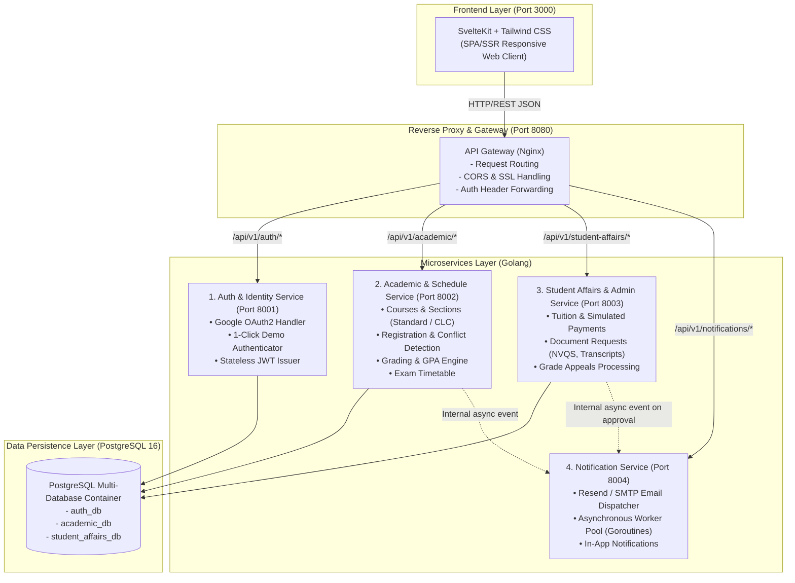
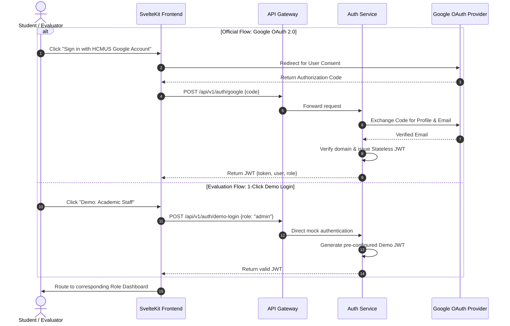

# System Architecture & Functional Specification Document - Portal67

**Project:** Portal67 - Unified Academic & Administrative Web Portal  
**Course:** Introduction to Software Engineering - Semester 1 (HK1), 2026–2027  
**Department:** Software Engineering Department, Faculty of Information Technology, HCMUS  
**Team:** Team 02 - BDD  
**Author (System Architect):** Vũ Trần Minh Hiếu (Student ID: 24127003)  
**Version:** 1.1 (Revised for PA2 Requirements & PA3 System Design)  
**Status:** Approved for Review  

---

## 1. System Overview & Problem Statement

### 1.1. Context & Background
Currently, students, faculty, and administrative staff at the University of Science, VNU-HCM (HCMUS) navigate across disconnected platforms and manual procedures:
* Academic portals and course catalogs are fragmented between the **Standard Program (Đại trà)** and the **High-Quality Program (Chất lượng cao - CLC)**.
* High peak-load traffic during course registration periods causes performance bottlenecks.
* Essential student workflows (e.g., student verification requests, military deferment certificates, tuition tracking, grade reviews, and GPA forecasting) are scattered across third-party forms (Google Forms) and separate websites.

### 1.2. Solution Vision
**Portal67** provides a unified, responsive, and high-performance portal that integrates academic scheduling, course registration, grading, financial tracking, and administrative document workflows.

The system is designed with a **Pragmatic Microservices Architecture**, optimized for local containerized deployment via **Docker Compose** without the operational overhead of Kubernetes or distributed service meshes, fitting the semester timeline and team velocity.

---

## 2. User Roles & Functional Decomposition Matrix (RBAC)

The system enforces strict Role-Based Access Control (RBAC) across three primary user groups:

```
                            ┌──────────────────────────────────────┐
                            │               PORTAL67               │
                            └──────────────────┬───────────────────┘
               ┌───────────────────────────────┼───────────────────────────────┐
               ▼                               ▼                               ▼
    ┌─────────────────────┐         ┌─────────────────────┐         ┌─────────────────────┐
    │       STUDENT       │         │       TEACHER       │         │   ACADEMIC STAFF    │
    │  (Standard & CLC)   │         │     (Lecturer)      │         │       (Admin)       │
    └─────────────────────┘         └─────────────────────┘         └─────────────────────┘
```

---

### 2.1. Student Subsystem (Student Portal)

Supports two distinct academic tracks:
* **Standard Track (Chương trình Đại trà)**
* **High-Quality Track (Chương trình Chất lượng cao - CLC)**: Differentiated credit tuition rates, specialized elective modules, and English-enhanced coursework.

| Category | Feature Name | Business Description | MoSCoW Priority |
| :--- | :--- | :--- | :--- |
| **1. Overview** | **Dashboard** | Displays announcements, daily class/exam agenda, pending tuition deadlines, and prioritized actionable to-dos. | **Must-have** |
| | **Student Profile** | Displays biographical records, contact details, academic advisor, home class, cohort, and academic program track (Standard vs. CLC). | **Must-have** |
| **2. Academic Affairs** | **Course Registration (ĐKHP)** | Browse open course sections (filtered by Standard / CLC tracks), view live seat availability, validate prerequisites, automatically detect timetable conflicts, and perform add/drop operations. | **Must-have** |
| | **Weekly Timetable** | Grid-based visual calendar of weekly class schedules with classroom locations, period slots, instructor information, and semester filtering. | **Must-have** |
| | **Grades & GPA Forecaster** | Comprehensive view of semester and cumulative grades (10-point and 4-point scales, GPA/CPA). What-if GPA calculator for graduation planning. | **Must-have** |
| | **Training Points (ĐRL)** | View training point history, complete online self-assessment per semester criteria, and track staff approval status. | **Should-have** |
| | **Exam Schedule** | List of scheduled exam slots, dates, shifts, candidate numbers (SBD), room allocations, and exam formats (written, multiple-choice, oral). Conflict detection included. | **Must-have** |
| | **Course Survey** | End-of-semester faculty and course evaluation forms (prerequisite for early grade viewing). | **Could-have** |
| **3. Examinations** | **Postponement & Retake** | Online submission of exam postponement requests (with medical/emergency attachments) and retake registration. | **Should-have** |
| | **Grade Appeal (Phúc khảo)** | Submit grade appeal requests for designated course components within the official review window; track review audit trail and updated scores. | **Must-have** |
| **4. Documents** | **Student Verification** | Request official verification certificates online (Military Service Deferment / NVQS, bank loan applications, visa, health insurance). | **Must-have** |
| | **Transcript Issuance** | Request certified paper transcripts or cryptographically verifiable PDF transcripts. | **Should-have** |
| | **Certificate Submission** | Submit foreign language (IELTS, TOEIC) and IT exit certifications for graduation requirement verification. | **Should-have** |
| **5. Finance** | **Tuition Management** | Itemized invoice breakdown per course section, total semester balance, payment deadlines, and policy-based waivers. Credit rate differentiated by Standard vs. CLC tracks. | **Must-have** |
| | **Tuition Deferment** | Submit tuition payment extension requests with supporting reasons and monitor approval status. | **Should-have** |
| | **Scholarships** | View academic excellence and corporate scholarship listings; submit application dossiers online. | **Could-have** |
| **6. Library** | **Library Services** | Search central library catalog, view book reservation status, and monitor return deadlines. | **Could-have** *(Deferred)* |

---

### 2.2. Lecturer Subsystem (Teacher Portal)

| Feature | Business Description | MoSCoW Priority |
| :--- | :--- | :--- |
| **1. Dashboard** | Summary of daily teaching schedules, upcoming grade submission deadlines, and pending administrative tasks. | **Must-have** |
| **2. Class & Student Management** | View assigned course sections, inspect student rosters, export attendance sheets, and broadcast announcements to enrolled students. | **Must-have** |
| **3. Teaching Timetable** | Weekly schedule view with room and period assignments; submit room-change or makeup-class requests. | **Must-have** |
| **4. Grade Entry & Monitoring** | Enter and modify continuous assessment scores (attendance, midterm, lab, project, final); import grades via Excel spreadsheets; automated weighted average computation. | **Must-have** |
| **5. Teaching Reports** | Lock grade books, sign and submit final score sheets to academic affairs, and inspect class score distribution analytics (histogram of letter grades). | **Should-have** |

---

### 2.3. Academic Staff Subsystem (Admin / Educational Affairs Portal)

| Feature | Business Description | MoSCoW Priority |
| :--- | :--- | :--- |
| **1. Student Management** | Manage student profiles, track academic standing (active, suspended, expelled, transferred), and handle program assignments (Standard vs. CLC). | **Must-have** |
| **2. Section Management** | Create administrative cohorts and semester course sections; configure maximum seating capacities, assigned faculty, and room slots. | **Must-have** |
| **3. Faculty Management** | Manage faculty directory, assign teaching workloads per section, and monitor department quotas. | **Must-have** |
| **4. Curriculum Management** | Maintain course catalog, credit allocations, and prerequisite dependency trees for Standard and CLC curriculum frameworks. | **Must-have** |
| **5. Timetable Management** | Schedule generation with conflict detection for rooms and instructors; publish official timetables prior to registration periods. | **Must-have** |
| **6. Grade & Academic Standing** | Open/close grade entry windows, validate finalized grades, process academic probation warnings, and adjudicate student grade appeals. | **Must-have** |
| **7. Exam & Event Scheduling** | Final exam timetable generation, seat and room allocations, conflict elimination, and proctor assignments. | **Must-have** |
| **8. Announcements** | Author and dispatch targeted or broadcast announcements (e.g., campus-wide, faculty-only, CLC students, tuition-overdue students). | **Must-have** |
| **9. Reports & Analytics** | Generate executive reports: registration demand, tuition payment status, department-wide grade distributions, and probation/scholarship lists. | **Should-have** |

---

## 3. System Architecture Design (Pragmatic Microservices)

The architecture adopts an isolated **Modular Microservices Pattern** managed by Docker Compose for reproducible local and demonstration environments.



---

## 4. Key Architectural Decisions (ADRs)

### 4.1. Authentication Architecture: Hybrid Authentication Strategy
* **Context:** The team evaluated Google OAuth 2.0 vs. traditional credential-based login.
* **Evaluation:**
  * **Google OAuth 2.0:** Highly secure and authentic to the HCMUS ecosystem (restricting logins to institutional domains). No password hashing or recovery workflows needed.
  * **Evaluation / Defense Risk:** Faculty reviewers, Teaching Assistants (TAs), and grading evaluators often do not possess pre-authorized institutional Google accounts or need to switch rapidly between roles (Standard Student, CLC Student, Teacher, Admin) during evaluation sessions.
* **Architectural Decision: Hybrid Authentication (Google OAuth + 1-Click Demo Bar)**
  1. **Primary Interface:** "Sign in with University Google Account" button for regular user authentication.
  2. **Evaluation Toolbar (1-Click Demo Bar):** Positioned discreetly in the footer of the login screen, allowing instant token generation for:
     * `[Demo: Standard Student]`
     * `[Demo: High-Quality (CLC) Student]`
     * `[Demo: Faculty / Lecturer]`
     * `[Demo: Academic Affairs Staff]`
  3. **Stateless JWT Authorization:** Tokens carry user identification, role, and program track (`program_type`), enabling downstream microservices to verify claims independently without remote auth queries.



---

### 4.2. Notification & Email Architecture
* **Requirement:** Automated dispatch of email notifications upon critical workflow triggers (document approval, grade appeal resolution, tuition reminders).
* **Architectural Decision:**
  1. **Delivery Provider:** Integration with **Resend API** (or Gmail SMTP with App Passwords), providing clean HTML templates and reliable delivery.
  2. **Asynchronous Non-blocking Worker:**
     * HTTP handlers process database updates and immediately push notification payloads into an in-memory **Go Buffered Channel**.
     * Handlers respond with HTTP 200 without waiting for remote network SMTP transmission.
     * Background **Goroutine Worker Pools** dequeue and execute email deliveries with retry mechanisms.
  3. **In-App Notification Fallback:** Every notification event creates a persistent record in the `notifications` table, ensuring users view pending alerts directly in their web notification center even without email access.

---

## 5. Course Phase Gates & Delivery Roadmap

| Phase Gate | Milestone | Core Team Deliverables | System Architect Responsibilities |
| :--- | :--- | :--- | :--- |
| **PA2 (Current)** | Requirements Specification (End of W5) | Complete SRS, Use Case Specifications, Screen Mockups. | Align architectural feasibility with BA; construct UI wireframes for Standard vs. CLC, Faculty, and Admin workflows. |
| **PA3** | System Design (End of W7) | C4 diagrams, ERDs, OpenAPI Specifications, Sequence Diagrams. | **Lead PA3:** Author C4 Container/Component models, produce PostgreSQL DDL schemas for all three service databases, define REST API specs. |
| **PA4** | Test Planning (End of W8) | Test strategy, test matrix, automated test cases, seed data. | Assist QA: Provide comprehensive SQL seed scripts (sample courses, overlapping schedules, test user profiles). |
| **PA5** | Construction & Deployment (Weeks 8–10) | Full working Go + Svelte implementation, Docker deployment, test verification. | **Co-lead developer:** Set up Nginx Gateway, implement Auth Service (Google OAuth + Demo), assist frontend-backend integration. |
| **Final Demo** | Final Presentation (Week 11) | Live demonstration of core workflows, final report. | Orchestrate live demo sequence: Course registration $\rightarrow$ Conflict resolution $\rightarrow$ Grade entry $\rightarrow$ Document approval. |

---

*This specification document is maintained in `docs/design/system-architecture-spec.md` as the authoritative technical baseline for Portal67.*
